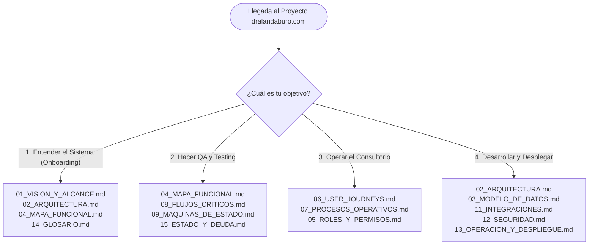

# 00 · Índice Maestro y Guía de Navegación

**Proyecto:** `dralandaburo.com`  
**Stack Principal:** Next.js 16 (App Router) + Supabase (PostgreSQL 15) + AWS EC2 (Bitnami Linux)  
**Dominio Oficial:** `https://dralandaburo.com` · Host: `54.94.94.20`  
**Fecha de Publicación:** 14 de Octubre de 2026  
**Último Commit Verificado:** `5ca414d`  
**Estado:** ✅ 100% Verificado contra el código fuente, base de datos de producción e infraestructura viva.

---

## 1. Mapa de Lectura según Rol y Objetivo

Para maximizar la eficiencia y evitar lecturas innecesarias, este cuerpo de conocimiento estructurado en 16 volúmenes ofrece cuatro recorridos recomendados:

### 1.1 Para Entender el Sistema Rápidamente (Nuevo Desarrollador o Agente IA)
1. [**01. Visión y Alcance**](./01_VISION_Y_ALCANCE.md): Propósito de la clínica, audiencias, qué resuelve y qué deliberadamente NO hace.
2. [**02. Arquitectura Técnica**](./02_ARQUITECTURA.md): Diagrama de despliegue, componentes, la trampa del standalone con doble `.env.local` y decisiones de arquitectura (ADRs).
3. [**04. Mapa Funcional**](./04_MAPA_FUNCIONAL.md): Mapa mental del sistema y matriz de los 5 estados de capacidad.
4. [**14. Glosario**](./14_GLOSARIO.md): Vocabulario médico, clínico, operativo y técnico indispensable.

### 1.2 Para Hacer QA Integral y Verificación
1. [**04. Mapa Funcional**](./04_MAPA_FUNCIONAL.md): Matriz de capacidades activas, desactivadas, degradadas y pendientes.
2. [**08. Flujos Críticos**](./08_FLUJOS_CRITICOS.md): Diagramas de secuencia de los 6 circuitos clave (compra online, stock, auth, n8n, borrado con auditoría, contacto).
3. [**09. Máquinas de Estado**](./09_MAQUINAS_DE_ESTADO.md): Restricciones `CHECK`, transiciones válidas e invariantes contables.
4. [**15. Estado y Deuda**](./15_ESTADO_Y_DEUDA.md): Listado de pruebas anti-fallbacks (15/15), bloqueos de negocio y backlog oficial `FIX-0XX`.

### 1.3 Para Operar el Consultorio y el Mostrador
1. [**05. Roles y Permisos**](./05_ROLES_Y_PERMISOS.md): Matriz de acceso por rol (`admin`, `medico`, `operativo`, `cosmetologa`).
2. [**06. User Journeys**](./06_USER_JOURNEYS.md): Los 8 perfiles reales de pacientes y colaboradores, y qué recorridos nunca han ocurrido en la realidad.
3. [**07. Procesos Operativos**](./07_PROCESOS_OPERATIVOS.md): Guías de apertura, recepción de pacientes, cobro en mostrador, arqueo de stock y cierre diario de caja.

### 1.4 Para Desarrollar Nuevas Funcionalidades y Desplegar
1. [**02. Arquitectura Técnica**](./02_ARQUITECTURA.md): Topología de servidores, proxy Apache y gestión de procesos PM2.
2. [**03. Modelo de Datos**](./03_MODELO_DE_DATOS.md): Catálogo exhaustivo de las 34 tablas, diagramas ER por dominios, claves foráneas `ON DELETE RESTRICT` y RPCs.
3. [**10. UX/UI y Patrones**](./10_UX_UI_Y_PATRONES.md): Brand tokens, paleta champagne, tipografías y catálogo de 46 componentes.
4. [**11. Integraciones**](./11_INTEGRACIONES.md): Mercado Pago, Resend, n8n, Meta CAPI/Pixel y Supabase Storage.
5. [**12. Seguridad**](./12_SEGURIDAD.md): Modelo STRIDE, políticas RLS tabla por tabla y aislamiento de secretos.
6. [**13. Operación y Despliegue**](./13_OPERACION_Y_DESPLIEGUE.md): Manual paso a paso, script postbuild de assets, rollback y regla de oro de DDL sin `BEGIN/COMMIT` único.

---

## 2. Índice General de los 16 Documentos Oficiales

| # | Documento | Resumen del Contenido | Audiencia Principal |
|---|---|---|---|
| **00** | [**00_INDICE.md**](./00_INDICE.md) | Mapa de lectura por rol, inventario general y tabla de absorción histórica. | Todos los lectores |
| **01** | [**01_VISION_Y_ALCANCE.md**](./01_VISION_Y_ALCANCE.md) | Propósito médico-comercial, audiencias, capacidades resueltas y límites de alcance. | Dirección, Producto, Devs |
| **02** | [**02_ARQUITECTURA.md**](./02_ARQUITECTURA.md) | Diagramas de despliegue y componentes, trampa del standalone y ADRs. | Arquitectos, DevOps, Devs |
| **03** | [**03_MODELO_DE_DATOS.md**](./03_MODELO_DE_DATOS.md) | Diagramas ER, 34 tablas detalladas, columnas, índices, RLS, triggers y 5 RPCs. | Backend, DBA, Devs |
| **04** | [**04_MAPA_FUNCIONAL.md**](./04_MAPA_FUNCIONAL.md) | Mindmap funcional, catálogo de 39 rutas y matriz de los 5 estados de capacidad. | QA, Producto, Devs |
| **05** | [**05_ROLES_Y_PERMISOS.md**](./05_ROLES_Y_PERMISOS.md) | RBAC de dos niveles, matriz de defaults y overrides, y 4 líneas defensivas de guards. | Seguridad, Dirección, Devs |
| **06** | [**06_USER_JOURNEYS.md**](./06_USER_JOURNEYS.md) | Los 8 perfiles del consultorio, puntos de dolor y recorridos ciegos nunca transitados. | UX/UI, Producto, Operativo |
| **07** | [**07_PROCESOS_OPERATIVOS.md**](./07_PROCESOS_OPERATIVOS.md) | Diagramas de actividad de apertura, atención, cobro, cierre de caja y arqueo. | Recepción, Operativo, Médicos |
| **08** | [**08_FLUJOS_CRITICOS.md**](./08_FLUJOS_CRITICOS.md) | Sequence diagrams de compra MP, stock, auth/RBAC, n8n, borrado y contacto. | Devs, QA, Integradores |
| **09** | [**09_MAQUINAS_DE_ESTADO.md**](./09_MAQUINAS_DE_ESTADO.md) | State diagrams con CHECKs reales para pedidos, tareas, gift cards, leads y CAPI. | Backend, QA, Devs |
| **10** | [**10_UX_UI_Y_PATRONES.md**](./10_UX_UI_Y_PATRONES.md) | Sistema visual, tokens champagne, CSS Modules, catálogo de 46 componentes y a11y. | Frontend, Diseñadores |
| **11** | [**11_INTEGRACIONES.md**](./11_INTEGRACIONES.md) | Mercado Pago, Resend, n8n, Meta CAPI/Pixel, GA4, Supabase Storage y Maps. | Integradores, DevOps, Devs |
| **12** | [**12_SEGURIDAD.md**](./12_SEGURIDAD.md) | Modelo STRIDE, RLS tabla por tabla, secretos y corrección de fugas históricas. | Seguridad, Backend, DevOps |
| **13** | [**13_OPERACION_Y_DESPLIEGUE.md**](./13_OPERACION_Y_DESPLIEGUE.md) | Manual de deploy SSH, PM2 reload, verificación anti-fallbacks, rollback y regla DDL. | DevOps, SysAdmin, Devs |
| **14** | [**14_GLOSARIO.md**](./14_GLOSARIO.md) | Definiciones rigurosas de términos médicos, operativos y técnicos de software. | Todos los lectores |
| **15** | [**15_ESTADO_Y_DEUDA.md**](./15_ESTADO_Y_DEUDA.md) | Estado al 14/10, tareas del backlog Notion (FIX-0XX), bloqueos y deuda técnica. | Dirección, Project Managers |

---

## 3. Mapa de Absorción y Superación de Documentos Históricos

Los 25 documentos preexistentes en `docs/` (fechados en su mayoría el 14 de Septiembre de 2026) se conservan intactos por motivos históricos y de auditoría, pero han sido formalmente superados por el nuevo cuerpo de 16 volúmenes verificado:

| Archivo Histórico (14/09/2026) | Documento Moderno Superador | Estado del Documento Histórico |
|---|---|:---:|
| `docs/01_SYSTEM_OVERVIEW.md` | [**01_VISION_Y_ALCANCE.md**](./01_VISION_Y_ALCANCE.md) | 📜 Superado (Describe 19 tablas; hoy hay 34). |
| `docs/02_TECHNICAL_ARCHITECTURE.md` | [**02_ARQUITECTURA.md**](./02_ARQUITECTURA.md) | 📜 Superado (Actualizado a Next.js 16 y Apache/PM2). |
| `docs/03_ROUTES_AND_INFORMATION_ARCHITECTURE.md` | [**04_MAPA_FUNCIONAL.md**](./04_MAPA_FUNCIONAL.md) | 📜 Superado (Incorpora 39 páginas y Kiosco iPad). |
| `docs/04_FUNCTIONAL_INVENTORY.md` | [**04_MAPA_FUNCIONAL.md**](./04_MAPA_FUNCIONAL.md) | 📜 Superado (Desglosado en matriz de 5 estados). |
| `docs/05_FEATURE_STATE_MATRIX.md` | [**04_MAPA_FUNCIONAL.md**](./04_MAPA_FUNCIONAL.md) & [**15_ESTADO_Y_DEUDA.md**](./15_ESTADO_Y_DEUDA.md) | 📜 Superado (Sincronizado con backlog FIX-0XX de Notion). |
| `docs/06_DATABASE.md` | [**03_MODELO_DE_DATOS.md**](./03_MODELO_DE_DATOS.md) | 📜 Superado (Relevaba 23 tablas; hoy documenta las 34). |
| `docs/07_API_DOCUMENTATION.md` | [**02_ARQUITECTURA.md**](./02_ARQUITECTURA.md) & [**08_FLUJOS_CRITICOS.md**](./08_FLUJOS_CRITICOS.md) | 📜 Superado (Actualizado a los 16 Route Handlers vivos). |
| `docs/08_SECURITY.md` | [**05_ROLES_Y_PERMISOS.md**](./05_ROLES_Y_PERMISOS.md) & [**12_SEGURIDAD.md**](./12_SEGURIDAD.md) | 📜 Superado (Refleja sellado RLS de tablas de backup). |
| `docs/09_USER_JOURNEYS.md` | [**06_USER_JOURNEYS.md**](./06_USER_JOURNEYS.md) & [**07_PROCESOS_OPERATIVOS.md**](./07_PROCESOS_OPERATIVOS.md) | 📜 Superado (Incorpora las 8 personas reales del consultorio). |
| `docs/10_UX_UI.md` | [**10_UX_UI_Y_PATRONES.md**](./10_UX_UI_Y_PATRONES.md) | 📜 Superado (Tokens normalizados y paleta champagne). |
| `docs/11_COMPONENT_INVENTORY.md` | [**10_UX_UI_Y_PATRONES.md**](./10_UX_UI_Y_PATRONES.md) | 📜 Superado (Inventario actualizado de 46 componentes). |
| `docs/12_PAYMENTS_AND_COMMERCE.md` | [**08_FLUJOS_CRITICOS.md**](./08_FLUJOS_CRITICOS.md) & [**11_INTEGRACIONES.md**](./11_INTEGRACIONES.md) | 📜 Superado (Documenta idempotencia y kill-switch en DB). |
| `docs/13_INTEGRATIONS.md` | [**11_INTEGRACIONES.md**](./11_INTEGRACIONES.md) | 📜 Superado (Incorpora Meta CAPI, Resend y n8n secrets). |
| `docs/14_INFRASTRUCTURE.md` | [**02_ARQUITECTURA.md**](./02_ARQUITECTURA.md) & [**13_OPERACION_Y_DESPLIEGUE.md**](./13_OPERACION_Y_DESPLIEGUE.md) | 📜 Superado (Topología real en AWS EC2 Bitnami). |
| `docs/15_CONFIGURATION.md` | [**02_ARQUITECTURA.md**](./02_ARQUITECTURA.md) & [**13_OPERACION_Y_DESPLIEGUE.md**](./13_OPERACION_Y_DESPLIEGUE.md) | 📜 Superado (Trampa del `.env.local` en modo standalone). |
| `docs/16_ERROR_AND_STATE_MODEL.md` | [**09_MAQUINAS_DE_ESTADO.md**](./09_MAQUINAS_DE_ESTADO.md) | 📜 Superado (Diagramas Mermaid de transiciones reales). |
| `docs/17_CONTENT_MODEL.md` | [**01_VISION_Y_ALCANCE.md**](./01_VISION_Y_ALCANCE.md) & [**14_GLOSARIO.md**](./14_GLOSARIO.md) | 📜 Superado (Actualizado a 120 tratamientos y 39 productos). |
| `docs/18_SEO_ACCESSIBILITY.md` | [**10_UX_UI_Y_PATRONES.md**](./10_UX_UI_Y_PATRONES.md) | 📜 Superado (Schemas JSON-LD de testimonios y a11y). |
| `docs/19_PERFORMANCE.md` | [**02_ARQUITECTURA.md**](./02_ARQUITECTURA.md) & [**13_OPERACION_Y_DESPLIEGUE.md**](./13_OPERACION_Y_DESPLIEGUE.md) | 📜 Superado (Métricas de bundle y optimización Turbopack). |
| `docs/20_TECHNICAL_DEBT.md` | [**15_ESTADO_Y_DEUDA.md**](./15_ESTADO_Y_DEUDA.md) | 📜 Superado (Mapeado contra IDs FIX-0XX de Notion). |
| `docs/21_CURRENT_STATE.md` | [**03_MODELO_DE_DATOS.md**](./03_MODELO_DE_DATOS.md) & [**15_ESTADO_Y_DEUDA.md**](./15_ESTADO_Y_DEUDA.md) | 📜 Superado (Fotografía viva de producción al 14/10/2026). |
| `docs/22_GLOSSARY.md` | [**14_GLOSARIO.md**](./14_GLOSARIO.md) | 📜 Superado (Glosario ampliado con términos clínicos y técnicos). |
| `docs/DOCUMENTATION_COVERAGE.md` | [**00_INDICE.md**](./00_INDICE.md) | 📜 Superado (Integrado en el nuevo índice maestro). |
| `docs/README.md` | [**README.md**](./README.md) (Actualizado) | 📜 Superado (Actualizado como portal hacia los 16 volúmenes). |
| `docs/RESPUESTAS_QA_03SEP_OLA5.md` | Archivo Histórico de QA | 📜 Histórico (Conservado como registro de la Ola 5). |
