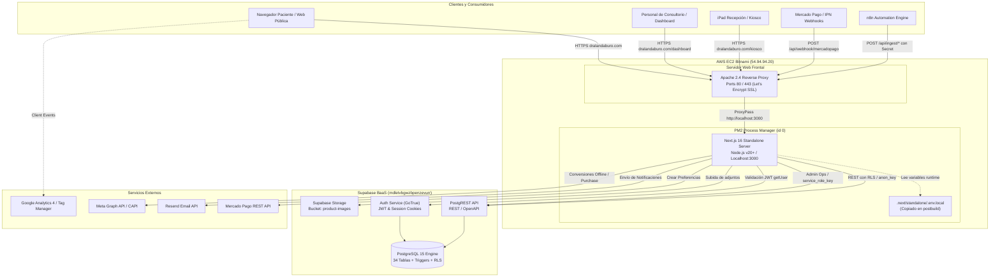
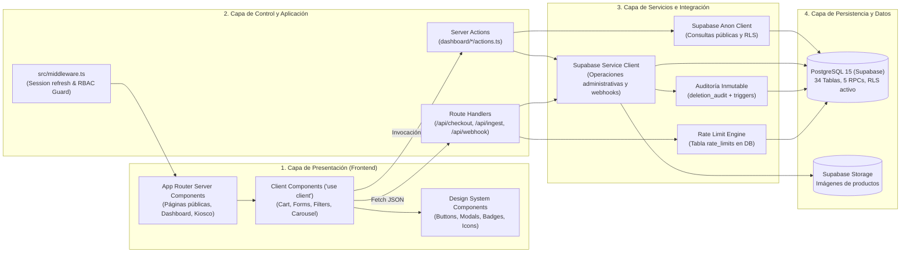

# 02 · Arquitectura Técnica y de Despliegue

**Proyecto:** `dralandaburo.com`  
**Stack Principal:** Next.js 16 (App Router) + Supabase (PostgreSQL 15) + AWS EC2 (Bitnami Linux)  
**Host de Producción:** AWS EC2 `54.94.94.20` · Dominio: `https://dralandaburo.com`  
**Gestor de Procesos:** PM2 (id `0`, app `dra-landaburo`) en puerto local `3000`  
**Servidor Web Frontal:** Apache 2.4 (Reverse Proxy SSL / Port 80 & 443)  
**Último commit verificado:** `5ca414d` (14/10/2026)  
**Estado:** ✅ 100% Verificado contra el código fuente, base de datos de producción e infraestructura viva.

---

## 1. Visión General del Sistema y Estilo Arquitectural

El sistema de `dralandaburo.com` implementa una arquitectura **híbrida moderna centrada en Next.js App Router (RSC - React Server Components)** con un backend desacoplado sobre **Supabase (PostgreSQL 15 + PostgREST + GoTrue Auth + Storage)**. Combina generación estática incremental, renderizado en servidor de alta velocidad y operaciones críticas server-to-server con aislamiento de secretos.

### Principios Fundamentales de la Arquitectura
1. **Server Components por Defecto:** Las vistas y layouts se resuelven en el servidor de Node.js mediante RSC, reduciendo el bundle transferido al cliente y blindando la lógica de negocio.
2. **Server Actions para Mutaciones del Dashboard:** La interacción del personal interno (`/dashboard/*`) opera con Server Actions tipadas (`src/app/dashboard/*/actions.ts`), utilizando cookies de sesión revalidadas dinámicamente.
3. **Route Handlers Especializados (`/api/*`):** La ingesta asíncrona de datos desde n8n, webhooks de pago (Mercado Pago), kiosco de recepción, rate limiting y endpoints anónimos se encapsulan en Route Handlers de Next.js con validación de cabeceras criptográficas o Bearer tokens.
4. **PostgREST + RLS como Capa de Acceso a Datos:** Acceso optimizado a PostgreSQL mediante políticas RLS (Row Level Security), complementado con cliente `service_role` restringido exclusivamente a tareas de backend que no pueden delegarse al navegador.
5. **Inmutabilidad y Trazabilidad:** Las tablas críticas de auditoría (`deletion_audit`, `stock_movements`, `mp_webhook_events`) operan como libros contables o append-only logs protegidos por triggers a nivel motor de base de datos.

---

## 2. Diagrama de Despliegue e Infraestructura (Deployment)

El tráfico ingresa a través de DNS y certificados SSL hacia la instancia de AWS EC2 Bitnami, donde Apache 2.4 termina la conexión TLS y delega la ejecución al runtime de Next.js Standalone administrado por PM2.



---

## 3. Diagrama de Capas y Componentes (Components Architecture)

La arquitectura de software se divide en cuatro capas claramente delimitadas, asegurando que ninguna credencial privilegiada se filtre al cliente web:



---

## 4. Dos Trampas Operativas Críticas de la Arquitectura

### 4.1 La Trampa del Standalone y el Doble `.env.local`
Next.js en modo `output: 'standalone'` empaqueta el servidor mínimo necesario en `.next/standalone/server.js`.
- **Comportamiento Crítico:** Cuando el servidor de producción arranca (`node server.js` bajo PM2), busca el archivo de variables de entorno en `.next/standalone/.env.local`, **NO** en la raíz `/opt/dra-landaburo/.env.local`.
- **Riesgo:** Si un operador edita `/opt/dra-landaburo/.env.local` y reinicia PM2 (`pm2 reload 0`), **los cambios no tienen ningún efecto**.
- **Solución Implementada:** El script `scripts/copy-standalone-assets.js` corre automáticamente en el hook `postbuild` (`npm run build`), copiando:
  1. `/opt/dra-landaburo/.next/static` → `.next/standalone/.next/static`
  2. `/opt/dra-landaburo/public` → `.next/standalone/public`
  3. `/opt/dra-landaburo/.env.local` → `.next/standalone/.env.local`
- **Regla Operativa:** Cualquier cambio manual en variables de entorno sin recompilar debe replicarse explícitamente a `.next/standalone/.env.local` antes de reiniciar PM2:
  ```bash
  cp /opt/dra-landaburo/.env.local /opt/dra-landaburo/.next/standalone/.env.local
  pm2 reload 0
  ```

### 4.2 La Trampa de la Cache de Esquema de PostgREST
Supabase utiliza PostgREST para exponer la base de datos vía HTTP.
- **Comportamiento Crítico:** PostgREST mantiene en memoria una cache del esquema relacional (columnas, tablas, relaciones foráneas y tipos).
- **Riesgo:** Si se ejecuta un DDL en la base de datos (por ejemplo, agregando una columna `meta_capi_status` o una tabla `rate_limits`), PostgREST responderá con error `PGRST204` ("Could not find the column in the schema cache") hasta que recargue la cache.
- **Solución Implementada:** Al final de cualquier migración o script DDL, se debe forzar la recarga ejecutando:
  ```sql
  NOTIFY pgrst, 'reload schema';
  ```
  O alternativamente, reiniciar el servicio PostgREST desde el Dashboard de Supabase.

---

## 5. Decisiones de Arquitectura (ADRs)

| ID | Decisión | Alternativa Evaluada | Justificación |
|---|---|---|---|
| **ADR-01** | **Next.js Standalone en EC2 Bitnami** | Vercel Serverless / Docker ECS | Previsibilidad de costos fijos, control completo sobre procesos de fondo, acceso directo a SSH y menor latencia con n8n alojado localmente. |
| **ADR-02** | **Acceso híbrido Supabase (RSC + Server Actions)** | Microservicios NestJS / Express | Elimina código boilerplate de CRUD, aprovecha RLS a nivel motor y centraliza la orquestación en TypeScript dentro del mismo monorepo. |
| **ADR-03** | **RBAC de Dos Niveles (`role_section_defaults` + `user_section_overrides`)** | Roles planos en JWT claims | Permite asignar excepciones individuales por usuario (ej. un empleado operativo que necesita ver caja) sin alterar la plantilla global del rol ni obligar a reautenticar al usuario. |
| **ADR-04** | **Idempotencia estricta en Webhooks MP (`mp_webhook_events`)** | Procesamiento volátil en memoria | Mercado Pago reenvía notificaciones múltiples veces. La tabla `mp_webhook_events` con clave única `event_id` y bloqueo de estado evita dobles acreditaciones y descuadre de stock. |
| **ADR-05** | **Auditoría Inmutable con Triggers (`deletion_audit`)** | Soft deletes (`deleted_at`) | El soft delete ensucia consultas y no captura el estado previo completo de la entidad. `deletion_audit` almacena un snapshot JSONB completo y cuenta con triggers que bloquean `UPDATE` y `DELETE` incluso ante `service_role`. |
| **ADR-06** | **Kill-Switch de Checkout Online en Base de Datos (`store_config.checkout_enabled`)** | Variable de entorno `CHECKOUT_ENABLED` | Permite a la dirección médica apagar la venta online de forma inmediata desde el dashboard sin requerir un despliegue de código ni reinicio de PM2. |
| **ADR-07** | **Desacople de Contacto Anónimo (`/api/contacto`) a Cliente Anon** | Inserción con `service_role` | Evita exponer privilegios de superusuario en una ruta pública. La tabla `leads` valida mediante RLS que `status = 'nuevo'`, `full_name IS NOT NULL` y aplica rate limiting en base de datos. |

---

## 6. Flujo de Datos y Conectividad

### 6.1 Circuito Sincrónico (Web Pública y Dashboard)
1. **Petición del Usuario:** Llega vía HTTPS a Apache 2.4 (puerto 443).
2. **Proxy Inverso:** Apache redirige `127.0.0.1:3000`.
3. **Middleware (`src/middleware.ts`):** 
   - Refresca cookies de sesión con `supabase.auth.getUser()`.
   - Verifica acceso a prefijos `/dashboard` y `/portal`. Redirige a `/login` si no hay sesión activa.
4. **Layout y Componentes:** El servidor renderiza los Server Components con datos consultados a PostgREST utilizando la sesión autenticada.
5. **Hidratación:** El cliente recibe el HTML listo con interactividad mínima en Client Components seleccionados.

### 6.2 Circuito Asincrónico de Ingesta (n8n Automation)
1. **Trigger de n8n:** n8n procesa registros clínicos o contables externos y genera un payload estructurado.
2. **Autenticación:** Realiza petición `POST /api/ingest/{payments|patients|cash-payments}` con cabecera `Authorization: Bearer <INGEST_SYNC_SECRET>`.
3. **Validación y Encolamiento:** El Route Handler valida el token. Si los datos son inconsistentes, los desvía a la tabla `ingest_review` con `status = 'pending'`. Si son consistentes, los impacta directamente en `payments` o `patients`.
4. **Revisión Manual:** El personal de consultorio accede a `/dashboard/revision` para resolver registros pendientes mediante Server Actions.
