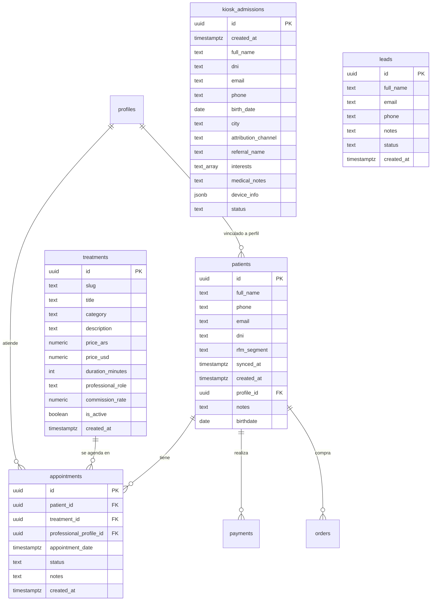
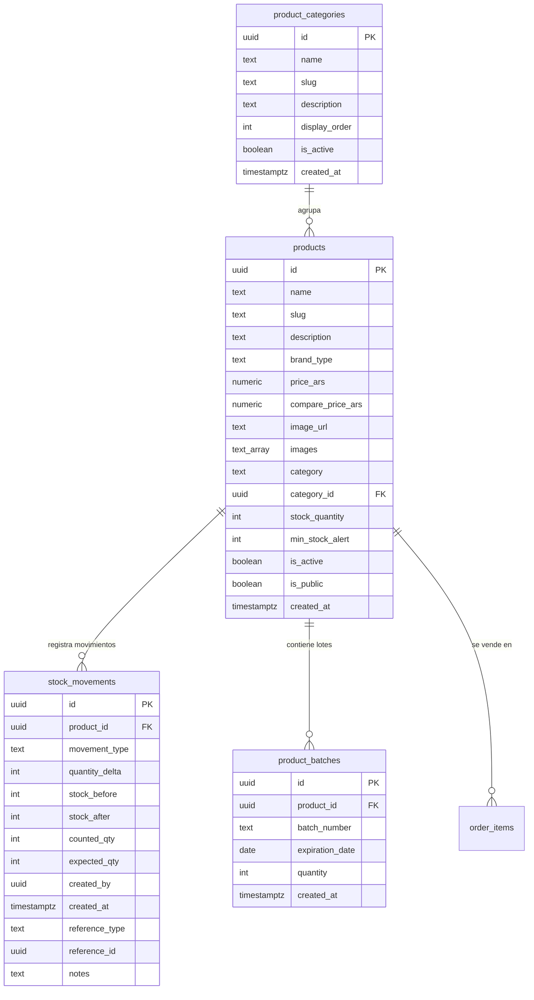
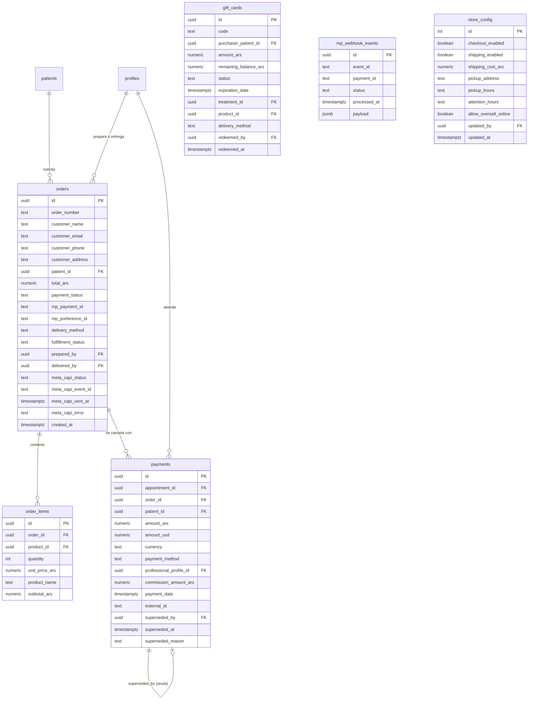
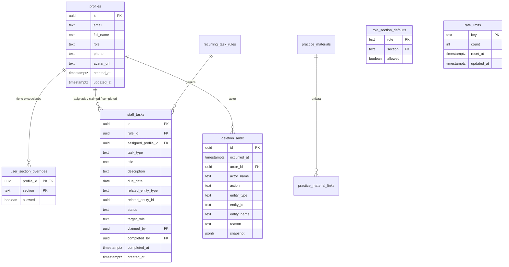

# 03 · Modelo de Datos y Esquema Relacional

**Proyecto:** `dralandaburo.com`  
**Motor de Base de Datos:** PostgreSQL 15.6 (Supabase cloud `mdletvbgwzbpenzevurr`)  
**Fecha de Relevamiento:** 14 de Octubre de 2026  
**Total de Tablas Operativas:** 32  
**Total de Tablas de Respaldo:** 2  
**Total de Tablas Relevadas:** 34  
**Total de Funciones RPC:** 5  
**Estado de Verificación:** ✅ 100% Verificado contra el catálogo real de PostgreSQL y PostgREST OpenAPI.

---

## 1. Resumen Ejecutivo del Modelo de Datos

La base de datos de producción administra tanto la operación clínica y comercial del consultorio como las funciones web públicas (turnos, tienda online, admisiones iPad y sincronización de marketing). El modelo cuenta con **34 tablas** en el esquema `public`, gobernadas por políticas de seguridad RLS (Row Level Security), restricciones `CHECK`, claves foráneas con reglas `ON DELETE` explícitas e inmutabilidad garantizada por triggers.

### Métricas de Filas Reales (14/10/2026)

| Dominio | Tabla | Filas | Propósito Principal |
|---|---|---:|---|
| **Clínico** | `patients` | 924 | Padrón unificado de pacientes (datos demográficos, RFM y DNI). |
| **Clínico** | `treatments` | 120 | Catálogo de tratamientos médicos y cosmiátricos con honorarios. |
| **Clínico** | `appointments` | 0 | Agenda de citas y turnos vinculados a paciente y profesional. |
| **Clínico** | `kiosk_admissions` | 0 | Admisiones digitales registradas desde el iPad de recepción. |
| **Clínico** | `leads` | 16 | Consultas web y formularios de contacto anónimos. |
| **Clínico** | `clinic_closed_days` | 0 | Feriados y días de cierre de consultorio para la agenda. |
| **Catálogo & Stock** | `products` | 39 | Productos para el cuidado de la piel (37 activos, 2 descontinuados). |
| **Catálogo & Stock** | `product_categories` | 13 | Categorías taxonómicas de productos (Limpieza, Serum, etc.). |
| **Catálogo & Stock** | `stock_movements` | 111 | Libro mayor inmutable de movimientos de inventario. |
| **Catálogo & Stock** | `product_batches` | 0 | Lotes y fechas de vencimiento de productos. |
| **Catálogo & Stock** | `inventory_items` | 0 | Insumos de uso médico interno (jeringas, gasas, etc.). |
| **Comercial & Pagos** | `payments` | 775 | Registro consolidado de cobros vigentes (efectivo, MP, transferencia). |
| **Comercial & Pagos** | `orders` | 0 | Pedidos online de la tienda con estados de pago y despacho. |
| **Comercial & Pagos** | `order_items` | 0 | Ítems individuales asociados a cada pedido. |
| **Comercial & Pagos** | `gift_cards` | 0 | Tarjetas de regalo digitales o físicas con código único. |
| **Comercial & Pagos** | `mp_webhook_events` | 0 | Registro idempotente de eventos IPN de Mercado Pago. |
| **Comercial & Pagos** | `store_config` | 1 | Parámetros globales de tienda, checkout, horarios y sobreventa. |
| **Comercial & Pagos** | `commission_rates` | 2 | Tasas de liquidación de honorarios por profesional y categoría. |
| **Ingesta & Marketing** | `ingest_review` | 344 | Cola de resolución manual de pagos o pacientes con discrepancias. |
| **Ingesta & Marketing** | `ad_campaigns` | 2 | Registro de campañas publicitarias activas en Meta Ads. |
| **Ingesta & Marketing** | `posts` | 5 | Artículos editoriales del blog médico. |
| **Ingesta & Marketing** | `cookie_consents` | 62 | Registro de consentimiento RGPD/Cookies de visitantes. |
| **Seguridad & Auditoría**| `profiles` | 10 | Usuarios del sistema y personal con roles asignados. |
| **Seguridad & Auditoría**| `role_section_defaults` | 32 | Matriz global de permisos por rol para el dashboard. |
| **Seguridad & Auditoría**| `user_section_overrides`| 2 | Excepciones individuales de acceso por usuario. |
| **Seguridad & Auditoría**| `deletion_audit` | 3 | Registro inmutable de eliminaciones y archivados con triggers. |
| **Seguridad & Auditoría**| `rate_limits` | 2 | Rate limiting persistente en base de datos. |
| **Gestión Operativa** | `staff_tasks` | 15 | Tareas operativas diarias de consultorio asignadas al personal. |
| **Gestión Operativa** | `recurring_task_rules` | 3 | Reglas automáticas para la generación de tareas recurrentes. |
| **Gestión Operativa** | `staff_guides` | 2 | Guías y procedimientos operativos estándar por rol. |
| **Materiales & Medios** | `practice_materials` | 1 | Archivos y consentimientos informados en almacenamiento. |
| **Materiales & Medios** | `practice_material_links`| 1 | Enlace polimórfico de materiales a tratamientos o productos. |
| **Respaldos Sellados** | `payments_backup_20260916` | 1072 | Respaldo sellado previo a la reconciliación contable (RLS activo). |
| **Respaldos Sellados** | `ingest_review_backup_20260916`| 320 | Respaldo histórico de cola de ingesta (RLS activo). |

---

## 2. Diagramas Entidad-Relación por Dominios (Mermaid)

### 2.1 Dominio Clínico y Pacientes


### 2.2 Dominio Catálogo, Inventario y Stock


### 2.3 Dominio Comercial, Ventas y Pagos


### 2.4 Dominio Seguridad, Roles, Tareas y Auditoría


---

## 3. Catálogo Detallado de Tablas

### 3.1 `patients` (924 filas)
Padrón maestro de pacientes del consultorio.
- `id` (uuid, PK, gen_random_uuid())
- `full_name` (text, NOT NULL)
- `phone` (text, NULL)
- `email` (text, NULL)
- `dni` (text, NULL)
- `rfm_segment` (text, DEFAULT 'Nuevo'): Segmentación recency-frequency-monetary.
- `synced_at` (timestamptz, NULL): Marca de tiempo de última sincronización n8n.
- `created_at` (timestamptz, NOT NULL DEFAULT now())
- `profile_id` (uuid, NULL, FK -> `profiles.id` ON DELETE SET NULL): Enlace si el paciente tiene cuenta de usuario.
- `notes` (text, NULL): Antecedentes médicos o comentarios clínicos.
- `birthdate` (date, NULL): Fecha de nacimiento.

### 3.2 `products` (39 filas)
Catálogo oficial de productos dermatológicos y de reventa.
- `id` (uuid, PK, gen_random_uuid())
- `name` (text, NOT NULL): Nombre comercial.
- `slug` (text, NOT NULL, UNIQUE)
- `description` (text, NULL): Descripción y principios activos.
- `brand_type` (text, NOT NULL): Marca comercial (ej. 'sulderm').
- `price_ars` (numeric, NULL): Precio de venta en Pesos Argentinos.
- `compare_price_ars` (numeric, NULL): Precio de lista para tachar en promociones.
- `image_url` (text, NULL): Imagen destacada.
- `images` (text[], NULL): Galería secundaria de imágenes.
- `category` (text, NULL): Nombre textual de categoría.
- `category_id` (uuid, NULL, FK -> `product_categories.id` ON DELETE SET NULL)
- `stock_quantity` (integer, NOT NULL DEFAULT 0): Stock físico disponible.
- `min_stock_alert` (integer, DEFAULT 5): Umbral de alerta de reposición.
- `is_active` (boolean, NOT NULL DEFAULT true): Si está activo en el sistema.
- `is_public` (boolean, NOT NULL DEFAULT true): Si es visible en la tienda online.
- `created_at` (timestamptz, NOT NULL DEFAULT now())

### 3.3 `stock_movements` (111 filas)
Libro diario de auditoría de inventario (inmutable).
- `id` (uuid, PK, gen_random_uuid())
- `product_id` (uuid, NOT NULL, FK -> `products.id` **ON DELETE RESTRICT**)
- `movement_type` (text, NOT NULL): CHECK (`movement_type IN ('ingreso_stock', 'ajuste_manual', 'venta_online', 'uso_gabinete', 'devolucion', 'recuento_fisico', 'scrap')`)
- `quantity_delta` (integer, NOT NULL): Variación numérica (positivo para ingreso, negativo para egreso).
- `stock_before` (integer, NOT NULL): Stock previo al movimiento.
- `stock_after` (integer, NOT NULL): Stock resultante (`stock_before + quantity_delta`).
- `counted_qty` (integer, NULL): Cantidad física contada en auditorías.
- `expected_qty` (integer, NULL): Cantidad teórica antes del recuento.
- `created_by` (uuid, NOT NULL): Operador que generó el movimiento.
- `created_at` (timestamptz, NOT NULL DEFAULT now())
- `reference_type` (text, NULL): Entidad vinculada ('order', 'audit', 'manual').
- `reference_id` (uuid, NULL): ID de la orden o referencia.
- `notes` (text, NULL): Justificación operativa.

### 3.4 `orders` (0 filas)
Cabecera de pedidos web realizados a través del checkout online.
- `id` (uuid, PK, gen_random_uuid())
- `order_number` (text, NOT NULL, DEFAULT format `ORD-YYYYMMDD-XXXXXXXX`)
- `customer_name` (text, NOT NULL)
- `customer_email` (text, NOT NULL)
- `customer_phone` (text, NULL)
- `customer_address` (text, NULL)
- `patient_id` (uuid, NULL, FK -> `patients.id` ON DELETE SET NULL)
- `total_ars` (numeric, NOT NULL)
- `payment_status` (text, NOT NULL DEFAULT 'pending'): CHECK (`payment_status IN ('pending', 'approved', 'rejected', 'cancelled', 'refunded')`)
- `mp_payment_id` (text, NULL): ID de transacción de Mercado Pago.
- `mp_preference_id` (text, NULL): ID de la preferencia generada para el checkout.
- `delivery_method` (text, NOT NULL DEFAULT 'retiro'): CHECK (`delivery_method IN ('retiro', 'envio')`)
- `delivery_address`, `delivery_city`, `delivery_postal_code`, `delivery_notes` (text, NULL)
- `fulfillment_status` (text, NOT NULL DEFAULT 'pendiente'): CHECK (`fulfillment_status IN ('pendiente', 'preparado', 'entregado', 'cancelado')`)
- `prepared_at` (timestamptz, NULL), `prepared_by` (uuid, NULL, FK -> `profiles.id`)
- `delivered_at` (timestamptz, NULL), `delivered_by` (uuid, NULL, FK -> `profiles.id`)
- `buyer_email_sent` (boolean, NOT NULL DEFAULT false), `buyer_email_error` (text, NULL)
- `staff_email_sent` (boolean, NOT NULL DEFAULT false), `staff_email_error` (text, NULL)
- `emails_attempted_at` (timestamptz, NULL)
- `meta_capi_status` (text, DEFAULT 'pending'): CHECK (`meta_capi_status IN ('pending', 'sent', 'failed', 'skipped')`)
- `meta_capi_event_id` (text, NULL): ID único de deduplicación con Meta Pixel.
- `meta_capi_sent_at` (timestamptz, NULL)
- `meta_capi_error` (text, NULL)
- `created_at` (timestamptz, NOT NULL DEFAULT now())
- `updated_at` (timestamptz, NOT NULL DEFAULT now())

### 3.5 `payments` (775 filas)
Libro contable unificado de cobranzas en consultorio y web.
- `id` (uuid, PK, gen_random_uuid())
- `appointment_id` (uuid, NULL, FK -> `appointments.id` ON DELETE SET NULL)
- `order_id` (uuid, NULL, FK -> `orders.id` ON DELETE SET NULL)
- `patient_id` (uuid, NULL, FK -> `patients.id` ON DELETE RESTRICT)
- `amount_ars` (numeric, NOT NULL)
- `amount_usd` (numeric, NULL)
- `currency` (text, NOT NULL DEFAULT 'ARS'): CHECK (`currency IN ('ARS', 'USD')`)
- `payment_method` (text, NOT NULL): CHECK (`payment_method IN ('efectivo', 'mercadopago', 'transferencia', 'debito', 'credito', 'otro')`)
- `professional_profile_id` (uuid, NULL, FK -> `profiles.id` ON DELETE SET NULL)
- `commission_amount_ars` (numeric, NOT NULL DEFAULT 0)
- `payment_date` (timestamptz, NOT NULL DEFAULT now())
- `external_id` (text, NULL): ID de recibo externo o n8n identifier.
- `notes` (text, NULL)
- `superseded_by` (uuid, NULL, FK -> `payments.id` ON DELETE SET NULL): Puntero al pago que reemplaza o anula a este registro.
- `superseded_at` (timestamptz, NULL)
- `superseded_reason` (text, NULL)

### 3.6 `deletion_audit` (3 filas)
Bitácora estricta de borrados y archivados de entidades críticas.
- `id` (uuid, PK, gen_random_uuid())
- `occurred_at` (timestamptz, NOT NULL DEFAULT now())
- `actor_id` (uuid, NULL, FK -> `profiles.id` ON DELETE SET NULL)
- `actor_name` (text, NOT NULL): Nombre inmutable del operador al momento de la acción.
- `action` (text, NOT NULL): CHECK (`action IN ('eliminado', 'archivado', 'restaurado')`)
- `entity_type` (text, NOT NULL): CHECK (`entity_type IN ('producto', 'tratamiento', 'material', 'campana', 'lead', 'gift_card')`)
- `entity_id` (text, NOT NULL): ID de la entidad afectada (almacenado como texto).
- `entity_name` (text, NOT NULL): Nombre o título de la entidad al borrarse.
- `reason` (text, NULL): Motivo especificado por el operador.
- `snapshot` (jsonb, NOT NULL): Dump JSON con todos los campos de la fila antes del borrado.
- **Triggers de inmutabilidad:** `trg_deletion_audit_no_update` y `trg_deletion_audit_no_delete` ejecutan `prevent_deletion_audit_change()`, bloqueando toda modificación o borrado incluso para `service_role`.

### 3.7 `store_config` (1 fila única, id = 1)
Parámetros del motor de comercio y atención física.
- `id` (integer, PK, DEFAULT 1)
- `checkout_enabled` (boolean, NOT NULL DEFAULT false): Interruptor maestro de venta online.
- `shipping_enabled` (boolean, NOT NULL DEFAULT false): Envío a domicilio disponible.
- `shipping_cost_ars` (numeric, NOT NULL DEFAULT 0): Tarifa fija de envío.
- `pickup_address` (text, DEFAULT 'Leandro N. Alem 45, Gualeguaychú, Entre Ríos')
- `pickup_hours` (text, DEFAULT 'Lunes a Viernes de 9:00 a 17:00 hs')
- `attention_hours` (text, DEFAULT 'Lun-Vier: 10:00 – 19:00 hs, Sáb: Solo con cita previa'): Horarios de atención clínica médica.
- `allow_oversell_online` (boolean, DEFAULT false): Si se permite vender productos con stock = 0.
- `updated_at` (timestamptz, NOT NULL DEFAULT now())
- `updated_by` (uuid, NULL, FK -> `profiles.id`)

### 3.8 `mp_webhook_events` (0 filas)
Recepción e idempotencia de notificaciones de Mercado Pago.
- `id` (uuid, PK, gen_random_uuid())
- `event_id` (text, NOT NULL, UNIQUE): Identificador único provisto por Mercado Pago.
- `payment_id` (text, NULL)
- `status` (text, NULL)
- `processed_at` (timestamptz, NOT NULL DEFAULT now())
- `payload` (jsonb, DEFAULT '{}'::jsonb)

### 3.9 `rate_limits` (2 filas)
Almacén persistente de rate limiting a nivel base de datos.
- `key` (text, PK): Identificador del recurso y cliente (`contacto:<ip>`, `checkout:<ip>`).
- `count` (integer, NOT NULL DEFAULT 1): Peticiones registradas en la ventana activa.
- `reset_at` (timestamptz, NOT NULL): Momento de expiración de la ventana.
- `updated_at` (timestamptz, NOT NULL DEFAULT now())

### 3.10 `staff_tasks` (15 filas) y `recurring_task_rules` (3 filas)
Gestor de tareas operativas y recordatorios del consultorio.
- `staff_tasks.id` (uuid, PK)
- `staff_tasks.rule_id` (uuid, NULL, FK -> `recurring_task_rules.id` ON DELETE SET NULL)
- `staff_tasks.assigned_profile_id` (uuid, NULL, FK -> `profiles.id`)
- `staff_tasks.task_type` (text, NOT NULL): CHECK (`task_type IN ('general', 'seguimiento_paciente', 'preparar_pedido', 'limpieza', 'inventario', 'campana')`)
- `staff_tasks.title` (text, NOT NULL)
- `staff_tasks.description` (text, NULL)
- `staff_tasks.due_date` (date, NOT NULL)
- `staff_tasks.related_entity_type` (text, NULL): Tipo de entidad vinculada.
- `staff_tasks.related_entity_id` (uuid, NULL): **Referencia Polimórfica** (puede apuntar a `patients.id`, `orders.id` u otra entidad).
- `staff_tasks.status` (text, NOT NULL DEFAULT 'pendiente'): CHECK (`status IN ('pendiente', 'en_progreso', 'completada', 'cancelada')`)
- `staff_tasks.target_role` (text, NULL): Rol al que se ofrece la tarea.
- `staff_tasks.claimed_by` (uuid, NULL, FK -> `profiles.id`)
- `staff_tasks.completed_by` (uuid, NULL, FK -> `profiles.id`)
- `staff_tasks.completed_at` (timestamptz, NULL)

### 3.11 `role_section_defaults` (32 filas) y `user_section_overrides` (2 filas)
Modelo de permisos del Dashboard en dos capas.
- `role_section_defaults`: Clave primaria compuesta (`role`, `section`). Define el acceso predeterminado por cada uno de los 5 roles (`admin`, `medico`, `recepcion`, `cosmetologa`, `operativo`).
- `user_section_overrides`: Clave primaria compuesta (`profile_id`, `section`). Permite conceder o denegar secciones específicas a un colaborador en particular sin cambiar su rol estructural.

---

## 4. Referencias Polimórficas (Puntos Ciegos Identificados)

En el diseño relacional existen dos columnas que actúan como punteros dinámicos sin restricción de clave foránea física a nivel motor:

1. **`staff_tasks.related_entity_id`:**
   - Acompañado de `related_entity_type` (`'paciente'`, `'pedido'`, `'campana'`, etc.).
   - Almacena el UUID de la fila en su tabla correspondiente.
   - **Riesgo:** Si se elimina un paciente con tareas pendientes, no habrá un borrado en cascada ni error RESTRICT en la base de datos.
   - **Mitigación:** La aplicación valida la existencia de la entidad antes de renderizar la tarjeta de tarea.
2. **`practice_material_links.entity_id`:**
   - Acompañado de `entity_type` (`'tratamiento'`, `'producto'`).
   - Conecta un documento informativo o consentimiento médico con un ítem del catálogo.
3. **`deletion_audit.entity_id`:**
   - Almacena como `text` el ID de la fila eliminada. Dado que la entidad de origen fue suprimida, la referencia es históricamente informativa y deliberadamente huérfana.

---

## 5. Funciones Almacenadas (RPCs) de Producción

### 5.1 `obtener_metricas_ejecutivas`
```sql
FUNCTION public.obtener_metricas_ejecutivas(
  p_start_date timestamptz,
  p_end_date timestamptz,
  p_cosmetologa_profile_id uuid DEFAULT NULL
)
RETURNS jsonb
LANGUAGE plpgsql
SECURITY DEFINER
SET search_path = public, auth
```
- **Autorización:** Valida que `auth.uid()` pertenezca a un perfil con rol `admin` o `medico`. Lanza excepción `42501` si no está autorizado.
- **Lógica de Cálculo:**
  - Suma ingresos vigentes (`amount_ars`, `amount_usd`) excluyendo cobros anulados (`superseded_by IS NULL`).
  - Agrupa la facturación por medio de pago (`payment_method`).
  - Calcula honorarios liquidados para profesionales asociados.

### 5.2 `is_admin`, `is_staff`, `is_internal_staff`
Funciones utilitarias ejecutadas en políticas RLS para verificar membresía de rol de forma atómica:
- `is_admin()`: Retorna `true` si el perfil del usuario actual tiene `role = 'admin'`.
- `is_staff()`: Retorna `true` si el perfil tiene `role IN ('admin', 'medico', 'recepcion', 'cosmetologa', 'operativo')`.
- `is_internal_staff()`: Excluye colaboradores externos de accesos sensibles.

### 5.3 `rls_auto_enable`
Trigger de evento a nivel esquema que asegura que cualquier nueva tabla creada en el esquema `public` tenga `ENABLE ROW LEVEL SECURITY` por defecto, previniendo exposiciones accidentales de datos.
