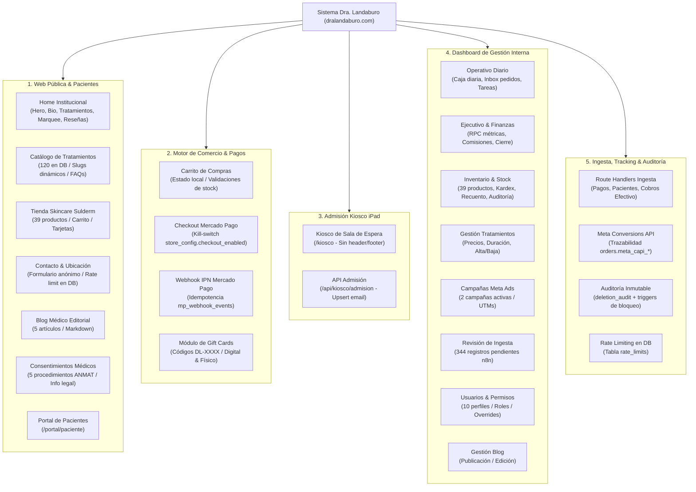

# 04 · Mapa Funcional y Matriz de Capacidades

**Proyecto:** `dralandaburo.com`  
**Fecha de Verificación:** 14 de Octubre de 2026  
**Módulos Evaluados:** 7 Áreas Funcionales (Web Institucional, Comercio Online, Kiosco de Recepción, Dashboard Operativo, Dashboard Ejecutivo, Ingesta Asíncrona, Tracking & Cumplimiento)  
**Estado:** ✅ 100% Verificado contra código fuente y base de datos de producción.

---

## 1. Diagrama Jerárquico del Sistema (Functional Mindmap)

---

## 2. Matriz de los 5 Estados de Capacidad

Para garantizar transparencia operativa y evitar asunciones, cada capacidad del sistema se categoriza estrictamente en uno de los siguientes 5 estados:

1. **🟢 Activo (Operativo Pleno):** Funcionalidad desplegada en producción, con interfaz gráfica, backend y base de datos sincronizados y en uso real.
2. **🟡 Desactivado por Configuración:** Funcionalidad completamente implementada a nivel código pero pausada voluntariamente mediante un flag dinámico en base de datos.
3. **🟠 Degradado / Fallback:** Funcionalidad operativa que recurre a un mecanismo alternativo seguro ante la ausencia de datos o dependencias externas.
4. **🔵 Bloqueado / Pendiente:** Desarrollado o parcialmente integrado, a la espera de credenciales, pasos de negocio externos o DDL.
5. **⚪ No Implementado:** Modelado conceptualmente o previsto en la arquitectura, pero sin vistas ni lógica implementada.

### Tabla Consolidada de Capacidades

| ID | Módulo / Funcionalidad | Ruta / Componente | Estado | Evidencia y Justificación Técnica |
|---|---|---|:---:|---|
| **CAP-01** | Catálogo y Detalle de Tratamientos | `/tratamientos`, `/tratamientos/[slug]` | 🟢 **Activo** | 120 tratamientos en DB, slugs dinámicos, renderizado SSR con fallback estático. |
| **CAP-02** | Catálogo de Productos Skincare | `/tienda`, `/tienda/[slug]` | 🟢 **Activo** | 39 productos (37 activos, 2 descontinuados), categorización taxonómica de 13 grupos. |
| **CAP-03** | Carrito de Compras Local | `/tienda/carrito`, `AddToCartButton` | 🟢 **Activo** | Estado persistente en `localStorage`, validación de stock disponible contra catálogo. |
| **CAP-04** | Checkout Online Mercado Pago | `/api/checkout/mercadopago` | 🟡 **Desactivado** | Controlado por `store_config.checkout_enabled = false`. El servidor retorna HTTP 403 y la UI oculta el botón de pago. |
| **CAP-05** | Envíos a Domicilio | `/tienda/carrito`, `store_config` | 🟡 **Desactivado** | `store_config.shipping_enabled = false`. Solo se ofrece la opción "Retiro en Consultorio". |
| **CAP-06** | Agenda de Turnos Online | Botón "Agendar Turno" / Hero CTA | 🟠 **Degradado** | Redirige a WhatsApp (`https://wa.me/5491169684062`). La tabla `appointments` tiene 0 filas; no hay selector de turnos interactivo. |
| **CAP-07** | Formulario de Contacto Web | `/contacto`, `/api/contacto` | 🟢 **Activo** | Inserción directa en tabla `leads` con rol anónimo, validación de status `'nuevo'` y rate limiting persistente en DB. |
| **CAP-08** | Kiosco de Recepción en Sala | `/kiosco`, `/api/kiosco/admision` | 🟢 **Activo** | Modo pantalla completa para iPad, upsert por email en `kiosk_admissions`, captura de canal de atribución e intereses. |
| **CAP-09** | Gestión de Stock y Movimientos | `/dashboard/productos/movimientos` | 🟢 **Activo** | 111 movimientos auditados, trazabilidad con stock previo y resultante, restricción física `ON DELETE RESTRICT`. |
| **CAP-10** | Recuento Físico de Inventario | `/dashboard/productos/recuento` | 🟢 **Activo** | Interfaz para arqueo ciego o guiado de stock con generación automática de movimientos de ajuste. |
| **CAP-11** | Auditoría Inmutable de Bajas | `/dashboard/productos/auditoria` | 🟢 **Activo** | 3 registros en `deletion_audit`. Protegido por triggers `trg_deletion_audit_no_update` y `no_delete`. |
| **CAP-12** | Panel de Cierre Diario | `/dashboard/cierre-diario` | 🟢 **Activo** | Reconciliación de cobros del día por medio de pago (efectivo, MP, transferencias) y arqueo de caja. |
| **CAP-13** | Métricas Ejecutivas de Facturación | `/dashboard/ejecutivo` | 🟢 **Activo** | Alimentado por RPC `obtener_metricas_ejecutivas`, cálculo de totales ARS/USD y honorarios liquidados. |
| **CAP-14** | Cola de Revisión de Ingesta | `/dashboard/revision` | 🟢 **Activo** | 344 registros en `ingest_review` esperando resolución manual o descarte por parte del personal operativo. |
| **CAP-15** | Control de Roles y Permisos | `/dashboard/usuarios` | 🟢 **Activo** | 10 perfiles, administración de roles (`admin`, `medico`, `operativo`, `cosmetologa`) y excepciones individuales. |
| **CAP-16** | Blog Médico Editorial | `/blog`, `/dashboard/blog` | 🟢 **Activo** | 5 artículos en tabla `posts`, renderizado de Markdown, endpoint de sincronización externa con Bearer token. |
| **CAP-17** | Tarjetas de Regalo (Gift Cards) | `/tienda/gift-cards`, `/api/gift-cards/*`| 🔵 **Bloqueado** | Estructura de base de datos lista (`gift_cards`), emisión y canje desarrollados pero bloqueados por la desactivación del checkout. |
| **CAP-18** | Meta Conversions API (CAPI) | `orders.meta_capi_*`, `/api/webhook/mp`| 🔵 **Bloqueado** | Columnas y worker preparados en `orders`. No ha registrado envíos reales (`orders` tiene 0 filas) a la espera del primer pedido online. |
| **CAP-19** | Control de Lotes y Vencimientos | `product_batches` | ⚪ **No Impl.** | Tabla creada en Supabase (0 filas), sin interfaz en el dashboard ni lógica de descuento FEFO/FIFO en stock. |
| **CAP-20** | Gestión de Insumos Médicos Internos | `inventory_items` | ⚪ **No Impl.** | Tabla creada en Supabase (0 filas), sin interfaz gráfica desarrollada. |
| **CAP-21** | Consentimiento de Cookies (RGPD) | `CookieBanner`, `/api/cookies/consent` | 🟢 **Activo** | 62 registros en tabla `cookie_consents`, anonimización con hash de IP, control condicional de Meta Pixel y GA4. |

---

## 3. Navegación y Rutas del Sistema

### 3.1 Vistas Públicas (Acceso Universal)
- `/`: Portada institucional con secciones Hero, Bienvenida, Tratamientos destacados, Marquee de partners, Bio de la Dra. Landaburo, Contadores de experiencia, Equipo profesional, Reseñas verificadas de pacientes, CTA de Instagram y Footer dinámico.
- `/tratamientos`: Grilla completa de los 120 tratamientos organizados por categorías.
- `/tratamientos/[slug]`: Ficha clínica del tratamiento, descripción detallada, honorarios de referencia y preguntas frecuentes.
- `/tienda`: Catálogo de 39 productos con filtros por categoría y ordenamiento.
- `/tienda/[slug]`: Detalle del producto con galería de fotos, stock disponible y selector de unidades.
- `/tienda/carrito`: Carrito de compras con resumen de totales y selección de método de entrega.
- `/tienda/gift-cards`: Página de adquisición de tarjetas de regalo.
- `/contacto`: Información del consultorio (Alem 45, Gualeguaychú), mapa interactivo y formulario de consulta.
- `/sobre-mi`: Trayectoria profesional, formación médica y valores del consultorio.
- `/consentimientos`: Repositorio público de consentimientos informados bajo la Ley 26.529 de Derechos del Paciente.
- `/blog`: Listado de artículos médicos y divulgación sobre salud dermatológica.
- `/blog/[slug]`: Lectura completa del artículo editorial con metadatos OpenGraph.
- `/login`, `/registro`, `/recuperar-contrasena`, `/actualizar-contrasena`: Flujos de autenticación de usuarios.

### 3.2 Kiosco de Recepción (Modo Kiosco iPad)
- `/kiosco`: Vista limpia sin barra de navegación ni pie de página, orientada a tablets en la sala de espera para el auto-registro de nuevos pacientes.

### 3.3 Portal de Pacientes
- `/portal/paciente`: Panel privado para pacientes registrados (historial de consultas y pedidos).

### 3.4 Panel de Control Interno (`/dashboard/*`)
- `/dashboard/ejecutivo`: Vista consolidada de métricas de ingresos, distribución por medios de cobro y liquidación de profesionales. Incluye subpestaña de Cierre Diario.
- `/dashboard/operativo`: Centro de mando diario con bandeja de pedidos web por empaquetar, lista de tareas pendientes del personal y admisiones del kiosco.
- `/dashboard/productos`: Maestro de productos, edición rápida de precios y stock.
- `/dashboard/productos/movimientos`: Kardex histórico de movimientos de inventario con filtros de fecha y tipo.
- `/dashboard/productos/recuento`: Herramienta de arqueo físico de inventario.
- `/dashboard/productos/auditoria`: Bitácora inmutable de eliminaciones y archivados (`deletion_audit`).
- `/dashboard/productos/categorias`: Gestión de categorías taxonómicas.
- `/dashboard/tratamientos`: Mantenimiento del catálogo de tratamientos, honorarios y duración en minutos.
- `/dashboard/campanas`: Panel de visualización de campañas de Meta Ads activas y guías de respuesta comercial.
- `/dashboard/revision`: Bandeja de reconciliación de datos clínicos o cobros desfasados provenientes de n8n.
- `/dashboard/usuarios`: Administración de usuarios, asignación de roles y control granular de excepciones por sección.
- `/dashboard/blog`: Editor y gestor de publicaciones del blog institucional.
- `/dashboard/sin-acceso`: Pantalla de bloqueo defensiva cuando un usuario autenticado intenta acceder a una sección restringida.
