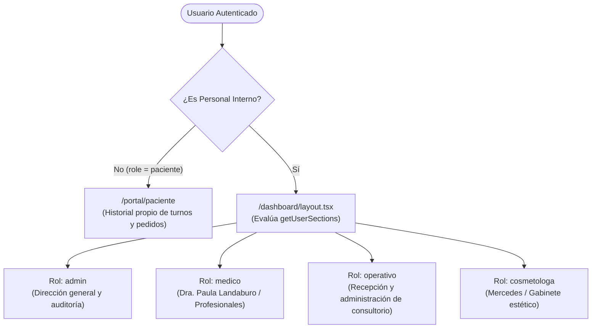
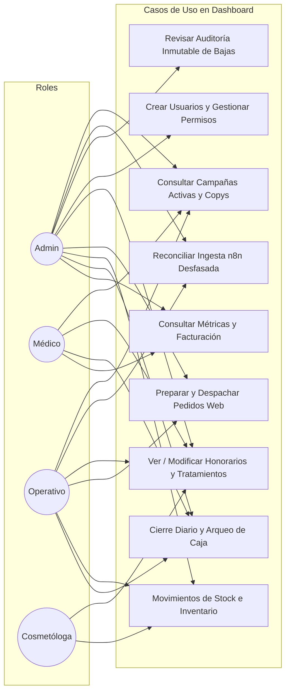
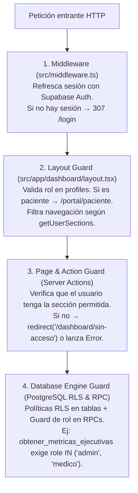

# 05 · Roles, Permisos y Control de Acceso (RBAC)

**Proyecto:** `dralandaburo.com`  
**Modelo de Seguridad:** Control de Acceso Basado en Roles (RBAC) de Dos Niveles  
**Fecha de Verificación:** 14 de Octubre de 2026  
**Perfiles Activos en Producción:** 10 usuarios en tabla `profiles`  
**Estado:** ✅ 100% Verificado contra base de datos real y lógica de servidor en Next.js.

---

## 1. Definición de Roles del Sistema

El sistema categoriza a los usuarios en cinco roles formales: cuatro roles internos con acceso al panel de gestión (`/dashboard/*`) y un rol de paciente externo para el autoservicio (`/portal/paciente`).



### Características de Cada Rol

| Rol | Audiencia / Cargo | Propósito Principal | Restricciones Clave |
|---|---|---|---|
| **`admin`** | Dirección General / Agustín Landaburo | Control absoluto del sistema, gestión de usuarios, auditoría de bajas (`deletion_audit`), configuración de tienda y métricas financieras. | Acceso irrestricto sin evaluación de defaults. |
| **`medico`** | Dra. Paula Landaburo y médicos asociados | Supervisión clínica, monitoreo ejecutivo de facturación, cierre de caja diario, catálogo médico y campañas. | Sin acceso a gestión de usuarios ni edición de stock de reventa. |
| **`operativo`** | Recepción / Personal de mostrador | Operación diaria, arqueo de caja, preparación de pedidos, despacho de productos, registro de stock y resolución de ingesta. | Bloqueado de métricas ejecutivas globales y gestión de usuarios. |
| **`cosmetologa`** | Cosmiatra / Personal de gabinete | Consulta de turnos diarios, registro de insumos consumidos en cabina y visualización de catálogo de tratamientos. | Sin acceso a facturación global, caja diaria ni administración de usuarios. |
| **`paciente`** | Paciente registrado en la web | Consulta de turnos pasados y seguimiento de pedidos de skincare. | Bloqueado de raíz de cualquier ruta bajo `/dashboard/*` por el layout. |

---

## 2. Arquitectura de Permisos de Dos Niveles

El sistema no utiliza roles rígidos cableados en código, sino un **esquema de resolución dinámica en dos niveles**:

1. **Nivel 1: Defaults por Rol (`role_section_defaults`):** Define qué secciones del dashboard están habilitadas de forma predeterminada para cada rol.
2. **Nivel 2: Excepciones por Usuario (`user_section_overrides`):** Permite conceder o revocar acceso a una sección específica para un usuario determinado, sin necesidad de modificar el rol global ni alterar los permisos de sus compañeros.

### Lógica de Evaluación en Servidor (`src/lib/permissions.ts`)
```typescript
// Si es admin -> Acceso total inmediato
if (role === "admin") return { allowed: ALL_SECTIONS };

// 1. Obtener defaults del rol desde DB
const defaults = await getRoleDefaults(role);

// 2. Obtener overrides individuales del perfil
const overrides = await getUserOverrides(profileId);

// 3. Resolver: El override tiene precedencia absoluta sobre el default del rol
for (const section of ALL_SECTIONS) {
  if (overrides.has(section)) {
    if (overrides.get(section) === true) allowed.add(section);
  } else if (defaults.has(section)) {
    allowed.add(section);
  }
}
```

---

## 3. Matriz Real de Permisos por Rol (14/10/2026)

Valores verificados directamente en la tabla `role_section_defaults` de la base de datos de producción:

| Sección del Dashboard | Ruta Asociada | `admin` | `medico` | `operativo` | `cosmetologa` | `paciente` |
|---|---|:---:|:---:|:---:|:---:|:---:|
| **`ejecutivo`** | `/dashboard/ejecutivo` | ✅ Permitido | ✅ Permitido | ❌ Denegado | ❌ Denegado | ❌ Denegado |
| **`cierre-diario`** | `/dashboard/cierre-diario` | ✅ Permitido | ✅ Permitido | ✅ Permitido | ❌ Denegado | ❌ Denegado |
| **`operativo`** | `/dashboard/operativo` | ✅ Permitido | ✅ Permitido | ✅ Permitido | ✅ Permitido | ❌ Denegado |
| **`productos`** | `/dashboard/productos` | ✅ Permitido | ❌ Denegado | ✅ Permitido | ✅ Permitido | ❌ Denegado |
| **`tratamientos`** | `/dashboard/tratamientos` | ✅ Permitido | ✅ Permitido | ✅ Permitido | ✅ Permitido | ❌ Denegado |
| **`campanas`** | `/dashboard/campanas` | ✅ Permitido | ✅ Permitido | ✅ Permitido | ❌ Denegado | ❌ Denegado |
| **`revision`** | `/dashboard/revision` | ✅ Permitido | ❌ Denegado | ✅ Permitido | ❌ Denegado | ❌ Denegado |
| **`usuarios`** | `/dashboard/usuarios` | ✅ Permitido | ❌ Denegado | ❌ Denegado | ❌ Denegado | ❌ Denegado |
| **`blog`** | `/dashboard/blog` | ✅ Permitido | ❌ Denegado | ❌ Denegado | ❌ Denegado | ❌ Denegado |

> **Nota Operativa:** `cierre-diario` y `revision` se integran visualmente como pestañas dentro de la sección Ejecutiva en el layout moderno, pero mantienen sus tokens de permiso independientes para que el personal operativo pueda ingresar directamente a `/dashboard/ejecutivo?tab=cierre-diario` sin tener acceso al panel de facturación general.

---

## 4. Excepciones Individuales Activas en Producción

Consultadas en la tabla `user_section_overrides` al 14/10/2026:

| Usuario | Rol Base | Sección | Permiso Override | Justificación Operativa |
|---|---|---|:---:|---|
| **María Laura Dzuryk** | `operativo` | `revision` | ❌ **Denegado** (`allowed: false`) | Restricción puntual para evitar que la recepcionista altere la cola de reconciliación contable de n8n. |
| **Cecilia Morel** | `admin` | `revision` | ❌ **Denegado** (`allowed: false`) | Aislamiento administrativo de la bandeja de ingesta técnica. |

---

## 5. Diagrama de Casos de Uso por Rol (Mermaid)



---

## 6. Mecanismos de Protección Server-Side (Guards)

La seguridad del sistema está estructurada en **cuatro líneas de defensa defensivas**:



### 1. Guard de Middleware (`src/middleware.ts`)
- Intercepta todas las rutas excepto recursos estáticos.
- Llama a `supabase.auth.getUser()` contra el servidor de GoTrue para garantizar que el JWT no haya expirado ni sido revocado.
- Si un usuario anónimo intenta acceder a `/dashboard/*` o `/portal/*`, es redirigido inmediatamente a `/login?redirectTo=<ruta>`.
- Si un usuario ya autenticado intenta acceder a `/login` o `/registro`, es redirigido a `/`.

### 2. Guard de Layout (`src/app/dashboard/layout.tsx`)
- Se ejecuta en el servidor (RSC) antes de renderizar cualquier vista interna.
- Lee el rol desde `public.profiles`. Si el rol no pertenece a `['admin', 'medico', 'operativo', 'cosmetologa']`, redirige inmediatamente al portal de pacientes (`/portal/paciente`).
- Invoca `getUserSections(user.id, role)` y genera dinámicamente el menú lateral conteniendo únicamente los enlaces a los que el usuario tiene acceso legítimo.

### 3. Guards a Nivel de Página y Server Actions
- Cada página protegida (ej: `/dashboard/usuarios/page.tsx`) ejecuta `canAccessSection(user.id, role, 'usuarios')`.
- Si la verificación falla, interrumpe el ciclo de vida y redirige al usuario a `/dashboard/sin-acceso`.
- Las Server Actions (`src/app/dashboard/*/actions.ts`) no confían en la interfaz y repiten la verificación antes de ejecutar mutaciones en base de datos.

### 4. Guards a Nivel Motor de Base de Datos (PostgreSQL)
- **RLS:** Las tablas sensibles (`deletion_audit`, `payments_backup_20260916`, `ingest_review_backup_20260916`, `rate_limits`, `mp_webhook_events`) poseen RLS habilitado y deniegan acceso a usuarios anónimos o no autorizados.
- **RPC `obtener_metricas_ejecutivas`:** Cuenta con un guard en PL/pgSQL que verifica que `auth.uid()` posea rol `admin` o `medico`, arrojando un error `42501` si un usuario operativo intenta invocarla por la API REST.
- **Triggers de Inmutabilidad:** En `deletion_audit` y `stock_movements`, la integridad contable se defiende a nivel motor; nadie puede alterar un registro histórico.
