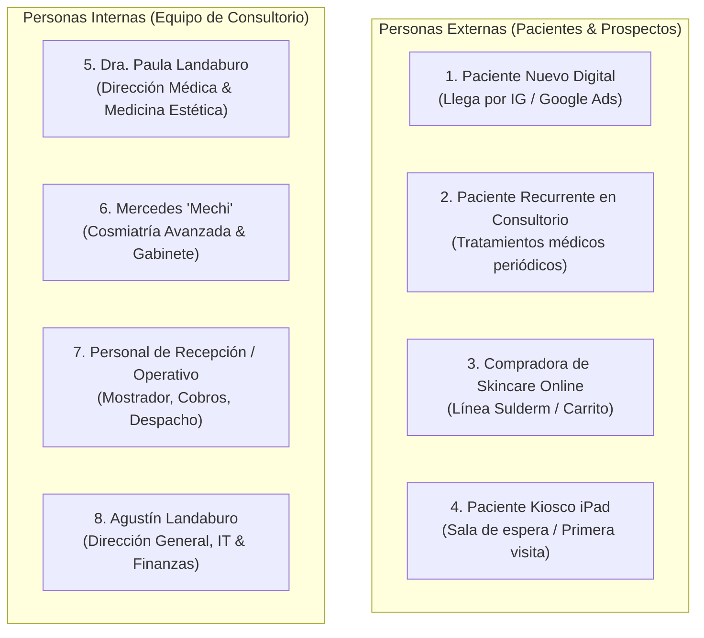

# 06 · Recorridos de Usuario (User Journeys) y Personas

**Proyecto:** `dralandaburo.com`  
**Fecha de Verificación:** 14 de Octubre de 2026  
**Personas Documentadas:** 8 Perfiles Reales del Ecosistema  
**Estado:** ✅ 100% Verificado contra la operativa real del consultorio y el código en producción.

---

## 1. Mapa de Personas Reales

---

## 2. Los 8 Recorridos Paso a Paso

### Persona 1: Paciente Nuevo Digital (Descubrimiento y Turno)
* **Perfil:** Mujer de 35 años, residente en Gualeguaychú o zonas aledañas (Fray Bentos, Concepción del Uruguay), interesada en Toxina Botulínica preventiva o Armonización Facial.
* **Canal de Ingreso:** Clic en anuncio de Instagram (`@dra_landaburo`) o búsqueda en Google.
* **Recorrido Real:**
  1. Aterriza en `/` o `/tratamientos/toxina-botulinica`.
  2. Lee la descripción médica, contraindicaciones y preguntas frecuentes.
  3. Hace clic en el botón principal "Agendar Consulta".
  4. Dado que no existe una turnera interactiva automatizada, el sistema la redirige de forma transparente a WhatsApp (`https://wa.me/5491169684062`) con un mensaje precargado.
  5. La recepcionista responde manualmente desde el WhatsApp oficial y le asigna fecha y hora.
* **Puntos de Dolor Identificados:**
  - Expectativa de agendar turno de forma 100% online con confirmación instantánea.
  - Horarios de respuesta limitados a la atención del mostrador.

---

### Persona 2: Paciente Recurrente en Consultorio (Atención Médica)
* **Perfil:** Paciente histórico (parte de los 924 registrados en `patients`), con historial de tratamientos y segmento RFM activo.
* **Recorrido Real:**
  1. Ingresa al consultorio en Leandro N. Alem 45.
  2. Pasa a consulta con la Dra. Paula Landaburo.
  3. Se realiza el procedimiento médico (ej. Rellenos con Ácido Hialurónico o Láser Nordlys).
  4. Pasa por el mostrador de recepción para abonar los honorarios.
  5. La recepcionista busca su ficha en el panel operativo y registra el pago en efectivo o transferencia, generando un registro en `payments`.
* **Puntos de Dolor Identificados:**
  - La sincronización histórica de recibos antiguos dependía de planillas procesadas por n8n, lo que en el pasado generó discrepancias que hoy descansan en `ingest_review`.

---

### Persona 3: Compradora de Skincare Online (Tienda Sulderm)
* **Perfil:** Paciente o cliente de retail interesada en productos dermatológicos recomendados para su rutina de cuidado domiciliario.
* **Recorrido Real:**
  1. Ingresa a `/tienda` y filtra por categoría (ej. "Limpieza" o "Sérum").
  2. Selecciona un producto (ej. Crema Hidratante Sulderm) y presiona "Agregar al carrito".
  3. Ingresa a `/tienda/carrito`. El sistema valida el stock disponible (`stock_quantity`).
  4. Intenta presionar "Comprar ahora".
  5. **Fase Actual:** El checkout online se encuentra pausado por configuración médica (`store_config.checkout_enabled = false`). La interfaz muestra un aviso informando que las compras online están transitoriamente pausadas y ofrece coordinar la compra por WhatsApp para retiro en consultorio.
* **Puntos de Dolor Identificados:**
  - Fricción de no poder pagar online con tarjeta de crédito/débito directamente en la web.

---

### Persona 4: Paciente Kiosco iPad (Admisión en Sala de Espera)
* **Perfil:** Paciente que asiste por primera vez al consultorio.
* **Recorrido Real:**
  1. En recepción se le entrega un iPad configurado en modo Kiosco (`/kiosco`).
  2. La pantalla de bienvenida ("Bienvenida/o al Consultorio") le solicita pulsar "Comenzar Registro".
  3. Completa: Nombre completo, DNI, Email, Teléfono/WhatsApp y Fecha de nacimiento.
  4. Selecciona cómo conoció el consultorio (Instagram, Anuncio, Google, Recomendación, Cartel/Paso u Otro). Si indica "Recomendación", escribe quién la recomendó.
  5. Marca sus áreas de interés (Botox, Ácido Hialurónico, Cosmiatría, etc.).
  6. Presiona "Confirmar Registro".
  7. El endpoint `/api/kiosco/admision` realiza un `upsert` por email en `kiosk_admissions` con estado `'nuevo'`.
  8. La pantalla muestra un tilde de confirmación y se reinicia automáticamente tras 8 segundos.
* **Puntos de Dolor Identificados:**
  - Si el iPad pierde conectividad Wi-Fi, no hay almacenamiento offline local (IndexedDB) para reintentar el envío.

---

### Persona 5: Dra. Paula Landaburo (Dirección Médica & Clínica)
* **Perfil:** Médica cirujana y especialista en medicina estética. Titular de la matrícula M.P. 11.439.
* **Recorrido Real:**
  1. Inicia sesión en `/login` con sus credenciales de rol `medico`.
  2. Accede a `/dashboard/ejecutivo` para evaluar la facturación del mes, desglose por medios de cobro y liquidación de honorarios mediante el RPC `obtener_metricas_ejecutivas`.
  3. Consulta `/dashboard/tratamientos` para verificar honorarios de referencia y tiempos estipulados por sesión.
  4. Consulta `/dashboard/cierre-diario` para supervisar la caja al término de la jornada.
* **Puntos de Dolor Identificados:**
  - Necesidad de consultar métricas consolidadas sin tener que interactuar con hojas de cálculo externas.

---

### Persona 6: Mercedes "Mechi" (Cosmiatría Avanzada & Gabinete)
* **Perfil:** Profesional a cargo de protocolos dérmicos, limpiezas profundas y aparatología. Rol: `cosmetologa`.
* **Recorrido Real:**
  1. Inicia sesión en `/login`. El layout le habilita únicamente las secciones `operativo`, `productos` y `tratamientos`.
  2. Accede a `/dashboard/operativo` para consultar las tareas asignadas para la jornada.
  3. Tras un tratamiento en gabinete, accede a `/dashboard/productos/movimientos` y registra el consumo de un insumo o producto con tipo de movimiento `uso_gabinete`, reduciendo el stock físico sin generar venta contable.
* **Puntos de Dolor Identificados:**
  - No debe tener visibilidad sobre cobros médicos ni facturación general del consultorio (aislamiento garantizado por RBAC).

---

### Persona 7: Personal de Recepción / Operativo (María Laura Dzuryk)
* **Perfil:** Encargada del mostrador, cobros, atención al público y control de insumos físicos. Rol: `operativo`.
* **Recorrido Real:**
  1. Inicia sesión en el panel de control.
  2. Mantiene abierto `/dashboard/operativo` durante el día para visualizar las admisiones del kiosco y la bandeja de pedidos web.
  3. Al recibir un pago físico, lo asienta en el sistema con medio de cobro (`efectivo`, `transferencia`, `mercadopago`).
  4. Al cierre del turno (17:00 / 19:00 hs), ingresa a `/dashboard/cierre-diario`, coteja el dinero en efectivo del cajón contra el sistema y genera el cierre de caja.
  5. Una vez al mes, accede a `/dashboard/productos/recuento` para realizar el arqueo físico de inventario.
* **Puntos de Dolor Identificados:**
  - Reconciliar transferencias que entran con demora a la cuenta bancaria.

---

### Persona 8: Agustín Landaburo (Administrador & Tecnología)
* **Perfil:** Responsable de la infraestructura, base de datos, integraciones de marketing y seguridad. Rol: `admin`.
* **Recorrido Real:**
  1. Accede con rol `admin` a todas las secciones del dashboard.
  2. Gestiona usuarios en `/dashboard/usuarios`, asignando roles y excepciones de sección en `user_section_overrides`.
  3. Supervisa `/dashboard/revision`, donde descansan 344 registros desfasados de n8n, resolviendo o descartando pagos mal imputados.
  4. En `/dashboard/productos/auditoria`, supervisa la bitácora inmutable `deletion_audit` para garantizar que ningún ítem haya sido eliminado sin justificación.
  5. Monitorea campañas en `/dashboard/campanas` y ajusta interruptores en `store_config`.

---

## 3. Recorridos Nunca Ocurridos en Producción (Caminos Ciegos)

Existen flujos de software completamente construidos en el código fuente que, por motivos de configuración o estado del negocio, **nunca se han ejecutado con datos reales en producción**:

1. **La Compra Online Completa de Punta a Punta:**
   - *Ruta:* `/tienda/carrito` → `/api/checkout/mercadopago` → Mercado Pago Checkout Pro → `/api/webhook/mercadopago` → Reducción de Stock → Disparo de Meta CAPI (`orders.meta_capi_status = 'sent'`).
   - *Causa:* La tabla `orders` posee exactamente **0 filas** debido a que `store_config.checkout_enabled = false`. El circuito está testeado en pruebas sintéticas pero jamás procesó una transacción comercial real en vivo.
2. **El Canje de una Gift Card Digital:**
   - *Ruta:* Adquisición en `/tienda/gift-cards` → Generación de código `DL-XXXX` → Canje en el mostrador vía `/api/gift-cards/redeem`.
   - *Causa:* La tabla `gift_cards` tiene **0 filas** emitidas en producción.
3. **El Auto-Agendamiento de Turnos Médico:**
   - *Ruta:* Selección de fecha y hora interactiva en el navegador → Inserción en `appointments`.
   - *Causa:* La tabla `appointments` tiene **0 filas**; la clínica optó operativamente por canalizar el 100% de la agenda a través de WhatsApp.
4. **Descuento de Stock por Lotes (FEFO/FIFO):**
   - *Ruta:* Venta de un producto con deducción automática del lote con fecha de expiración más próxima.
   - *Causa:* La tabla `product_batches` tiene **0 filas**.
