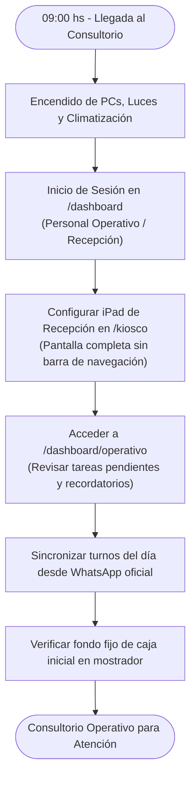
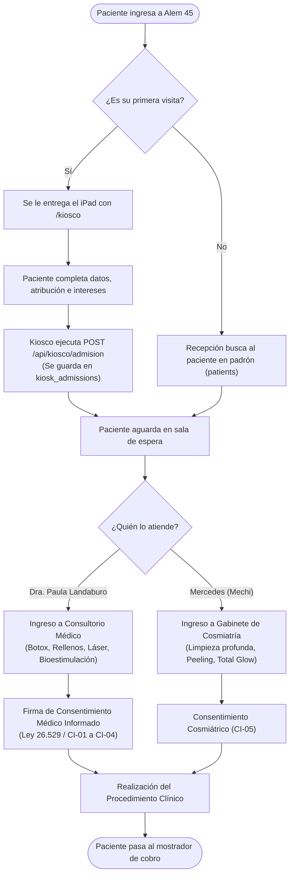
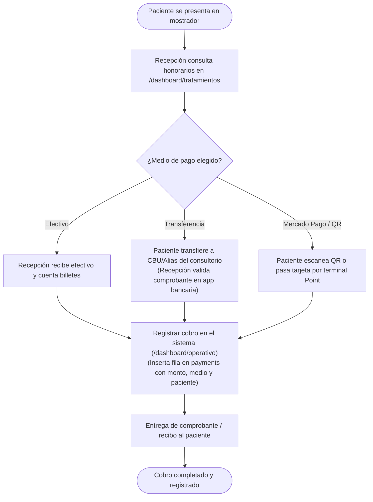
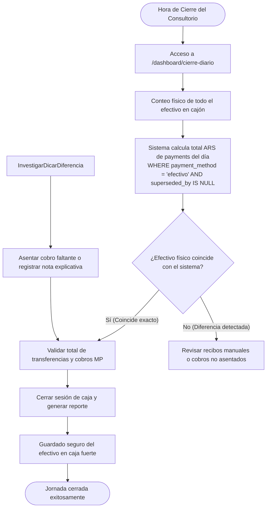
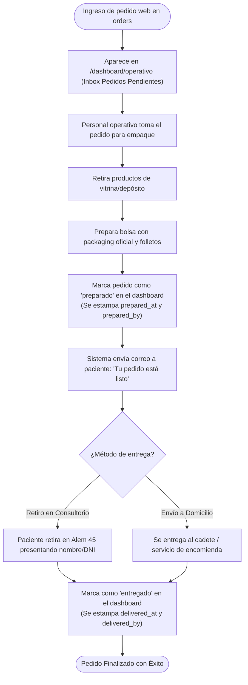

# 07 · Procesos Operativos de Consultorio

**Proyecto:** `dralandaburo.com`  
**Ubicación Física:** Leandro N. Alem 45, Gualeguaychú, Entre Ríos  
**Fecha de Verificación:** 14 de Octubre de 2026  
**Procesos Modelados:** Apertura, Recepción, Cobro, Cierre Diario, Inventario y Despacho  
**Estado:** ✅ 100% Verificado contra la rutina operativa y herramientas del sistema.

---

## 1. Proceso de Apertura de Consultorio y Comienzo del Día

Cada mañana (09:00 / 10:00 hs), el personal operativo y médico prepara las instalaciones y los sistemas para la jornada de atención.

---

## 2. Proceso de Recepción y Atención de Pacientes

Circuito desde que el paciente cruza la puerta hasta que ingresa al gabinete o consultorio médico.

---

## 3. Proceso de Cobro y Facturación en Mostrador

Liquidación económica del procedimiento médico o venta de productos de skincare.

---

## 4. Proceso de Cierre Diario de Caja (End of Day)

Al concluir las actividades de la tarde (17:00 / 19:00 hs), el personal operativo realiza el balance de caja para garantizar que no existan desfasajes entre el dinero físico y el sistema.

---

## 5. Proceso de Gestión y Arqueo Físico de Inventario

Garantiza la correspondencia 1:1 entre los 39 productos registrados en el sistema y las existencias físicas en vitrinas y depósitos.

```mermaid
flowchart TD
    subgraph IngresoMercaderia ["1. Ingreso de Nuevo Lote Sulderm"]
        LlegaPaquete["Llega encomienda de laboratorio a Alem 45"] --> CotejarRemito["Verificar unidades contra remito físico"]
        CotejarRemito --> RegistrarIngreso["Ir a /dashboard/productos/movimientos<br/>(Registrar 'ingreso_stock' con delta positivo)"]
        RegistrarIngreso --> ActualizaStock["El sistema actualiza stock_quantity automáticamente"]
    end

    subgraph ConsumoGabinete ["2. Uso de Insumos en Gabinete"]
        MechiAbreCrema["Mercedes utiliza producto en tratamiento"] --> RegistrarGabinete["Registrar 'uso_gabinete' en movimientos"]
        RegistrarGabinete --> DescuentaStock["Se descuenta stock físico sin generar cobro de venta"]
    end

    subgraph ArqueoMensual ["3. Arqueo Mensual de Inventario"]
        DiaArqueo["Jornada de Recuento Físico"] --> AbrirRecuento["Acceder a /dashboard/productos/recuento"]
        AbrirRecuento --> ConteoFisico["Conteo manual estante por estante"]
        ConteoFisico --> IngresoCantidades["Ingresar counted_qty por cada producto"]
        IngresoCantidades --> SistemaCalculaDiff["Sistema compara counted_qty vs stock_quantity actual"]
        SistemaCalculaDiff --> GenerarAjustes["Genera movimientos 'recuento_fisico' inmutables<br/>para igualar el stock real"]
    end
```

---

## 6. Proceso de Despacho de Pedidos Web (Modo Tienda Online)

Cuando el checkout online se encuentra activo (`store_config.checkout_enabled = true`), este es el protocolo de cumplimiento para los pedidos que ingresan por la web.

