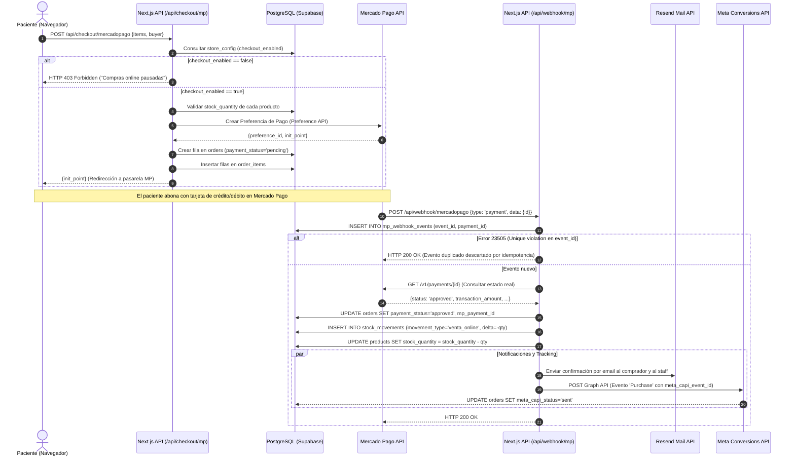
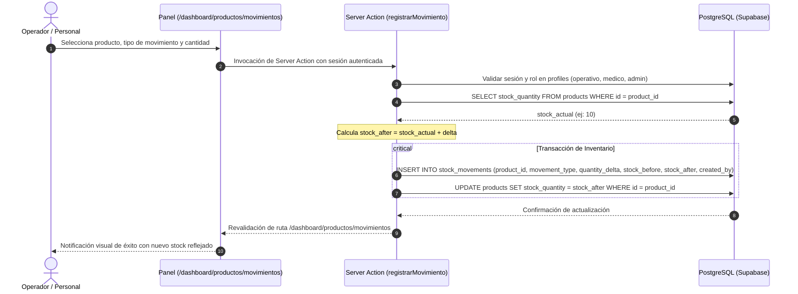
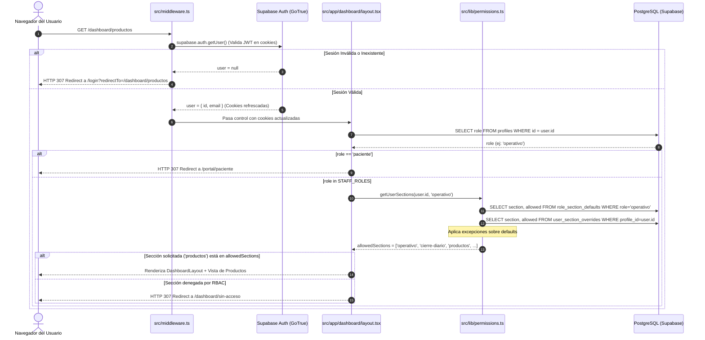
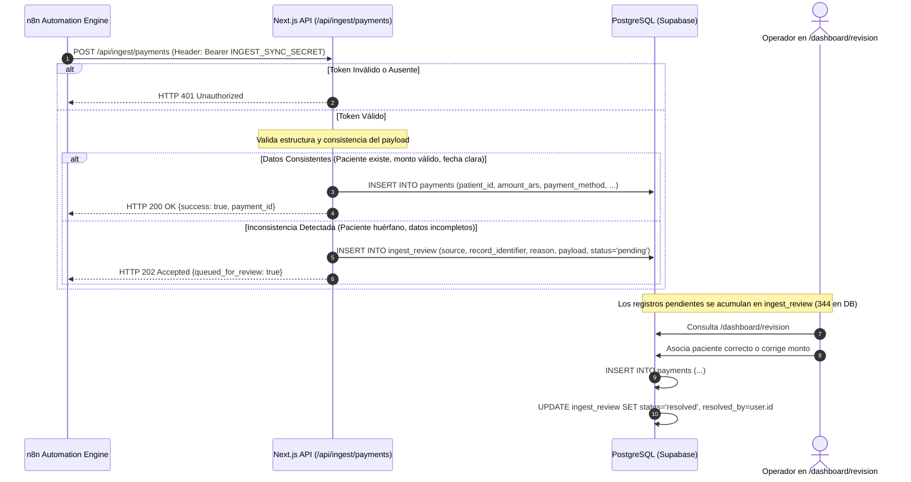
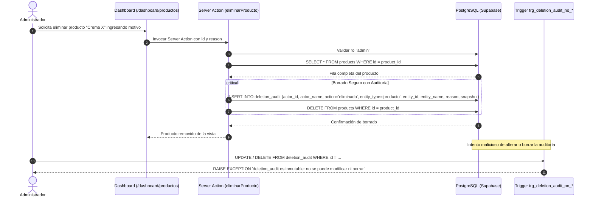
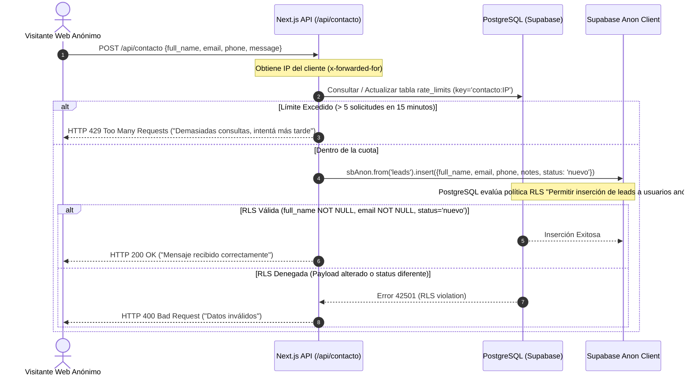

# 08 · Flujos Críticos del Sistema (Sequence Diagrams)

**Proyecto:** `dralandaburo.com`  
**Fecha de Verificación:** 14 de Octubre de 2026  
**Circuitos Documentados:** 6 Flujos Críticos de Software e Integración  
**Estado:** ✅ 100% Verificado contra código fuente, Route Handlers y triggers de PostgreSQL.

---

## 1. Circuito de Compra Online y Cobro con Mercado Pago

Flujo completo de checkout, webhook con deduplicación por clave única y disparo de integraciones.

---

## 2. Circuito de Movimiento de Stock e Inventario

Garantiza la trazabilidad del inventario y la restricción `ON DELETE RESTRICT`.

---

## 3. Circuito de Autenticación, Middleware y RBAC de Dos Niveles

Verificación estricta de sesión y filtrado dinámico de navegación.

---

## 4. Circuito de Ingesta Asíncrona de n8n y Cola de Revisión

Procesamiento de datos clínicos y contables externos con tolerancia a fallas.

---

## 5. Circuito de Borrado con Auditoría Inmutable

Protección de datos históricos mediante snapshot JSONB y bloqueo por triggers.

---

## 6. Circuito de Contacto Web Anónimo y Rate Limiting

Protección anti-spam y desacople de privilegios en el formulario público.

