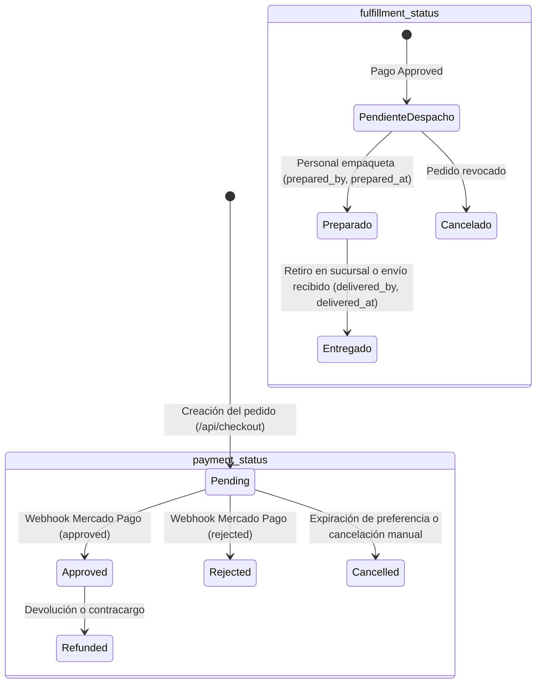
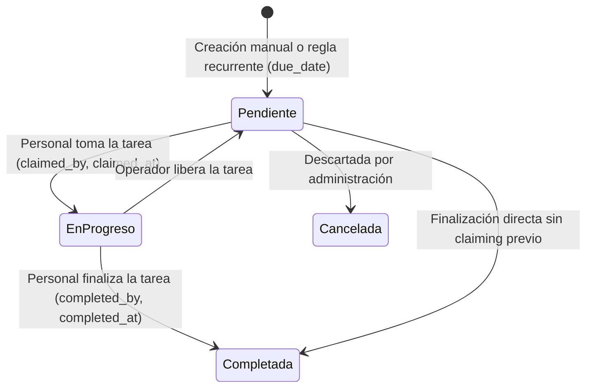
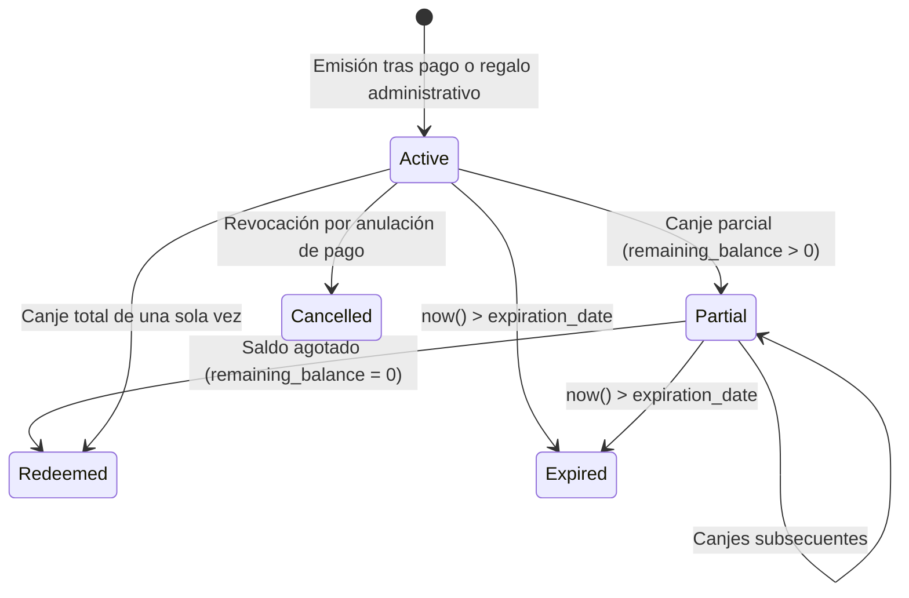
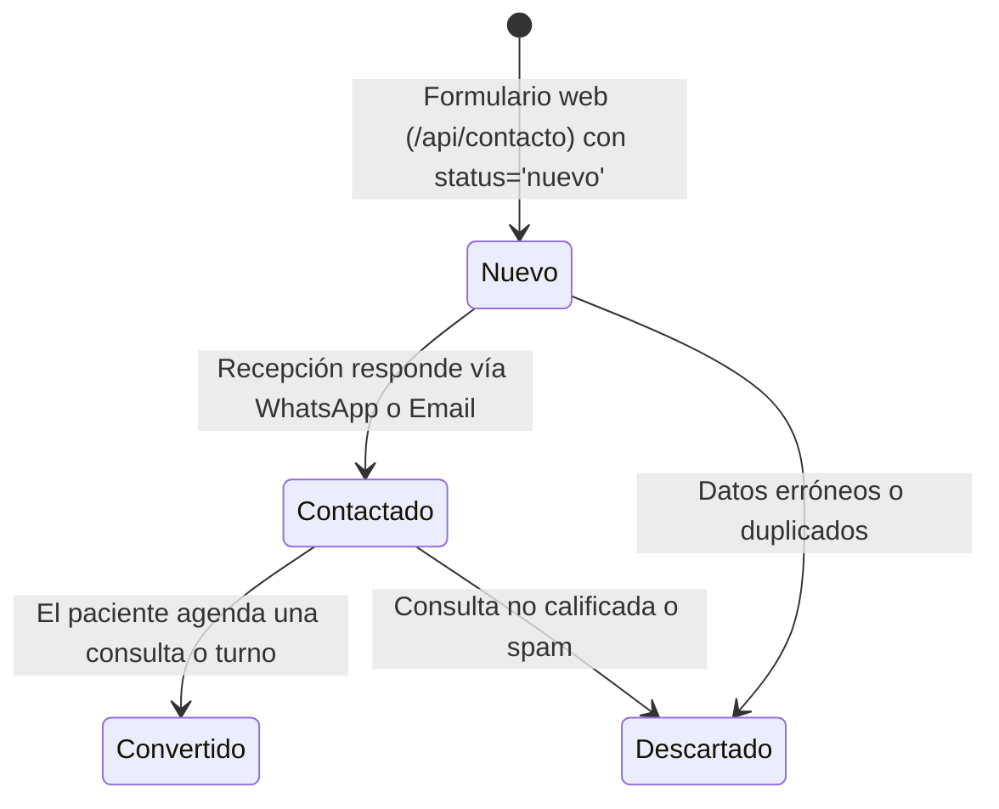
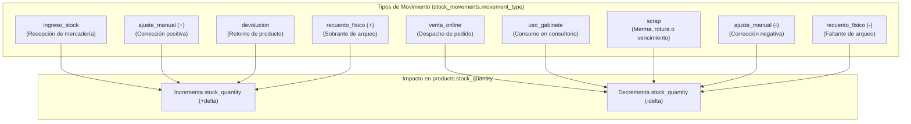
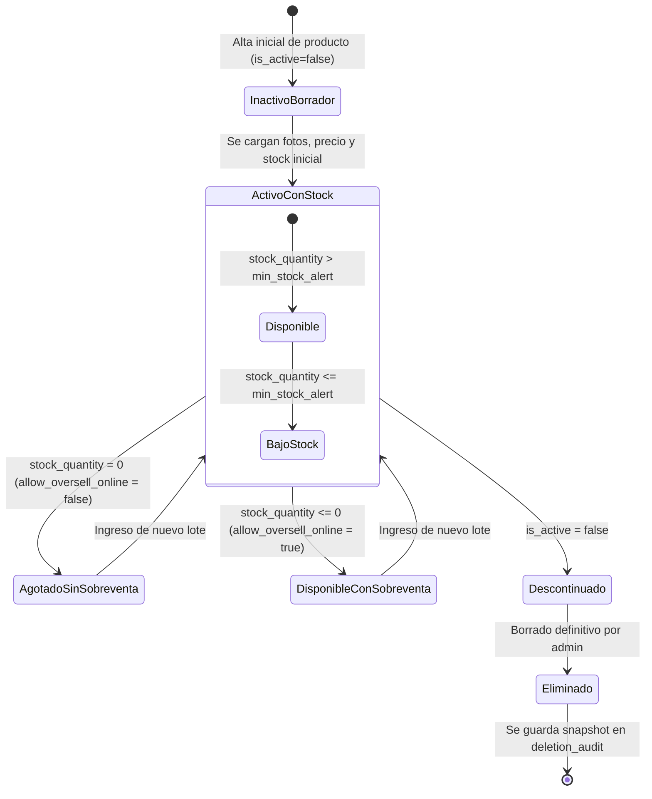
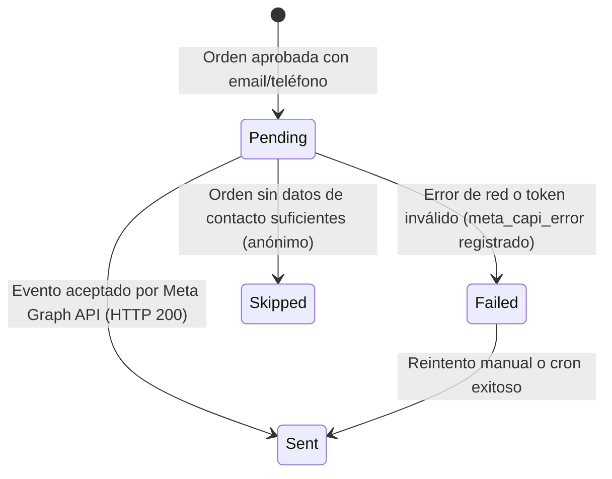
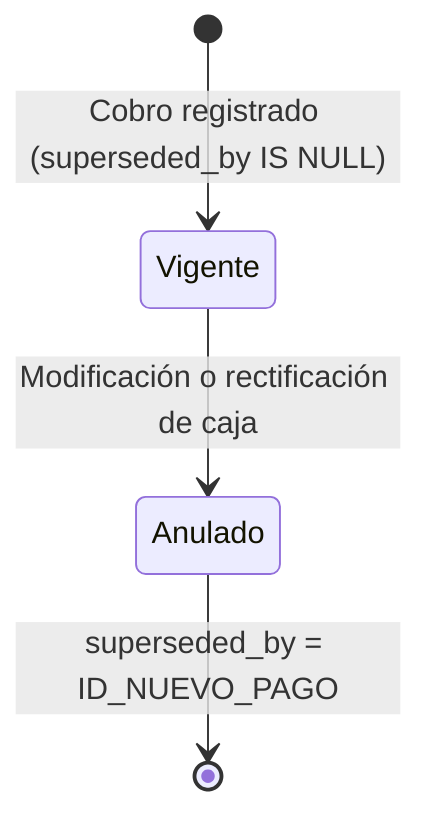

# 09 · Máquinas de Estado y Ciclos de Vida

**Proyecto:** `dralandaburo.com`  
**Fecha de Verificación:** 14 de Octubre de 2026  
**Entidades Modeladas:** Pedidos Web, Tareas de Personal, Gift Cards, Leads, Inventario, Productos, Meta CAPI y Pagos  
**Estado:** ✅ 100% Verificado contra restricciones `CHECK`, triggers y código de producción.

---

## 1. Ciclo de Vida del Pedido Web (`orders`)

El pedido web gestiona dos máquinas de estado concurrentes: **Estado del Pago** (`payment_status`) y **Estado de Cumplimiento / Despacho** (`fulfillment_status`).



### Restricciones y Reglas de Negocio
- `orders.payment_status` está restringido por CHECK: `'pending'`, `'approved'`, `'rejected'`, `'cancelled'`, `'refunded'`.
- `orders.fulfillment_status` está restringido por CHECK: `'pendiente'`, `'preparado'`, `'entregado'`, `'cancelado'`.
- **Regla de Interbloqueo:** Un pedido no puede pasar a `preparado` ni `entregado` en el dashboard mientras `payment_status != 'approved'`, a excepción de pedidos manuales coordinados por administración.
- **Transición a Preparado:** Requiere estampar `prepared_at = now()` y el UUID del operador en `prepared_by`.
- **Transición a Entregado:** Requiere estampar `delivered_at = now()` y el UUID del operador en `delivered_by`.

---

## 2. Ciclo de Vida de las Tareas de Personal (`staff_tasks`)

Las tareas operativas del consultorio (recordatorios de seguimiento a pacientes, reposición de insumos, preparación de paquetes) admiten asignación individual o toma voluntaria (claiming) por rol.



### Restricciones y Reglas de Negocio
- Restricción CHECK en `status`: `'pendiente'`, `'en_progreso'`, `'completada'`, `'cancelada'`.
- Tipos de tarea admitidos (`task_type`): `'general'`, `'seguimiento_paciente'`, `'preparar_pedido'`, `'limpieza'`, `'inventario'`, `'campana'`.
- Si una tarea posee `target_role` (ej. `'operativo'`), cualquier usuario con dicho rol puede transicionarla a `en_progreso`, momento en el cual queda estampada con su `claimed_by`.

---

## 3. Ciclo de Vida de las Gift Cards (`gift_cards`)

Las tarjetas de regalo se emiten con un código alfanumérico único (`code` formato `DL-XXXX-XXXX`), un monto en ARS y una fecha de caducidad.



### Restricciones y Reglas de Negocio
- Restricción CHECK en `status`: `'active'`, `'redeemed'`, `'partial'`, `'expired'`, `'cancelled'`.
- Restricción CHECK en `type`: `'monto'`, `'tratamiento'`.
- **Condición de Saldo:** Al crearse, `remaining_balance_ars = amount_ars`. En cada canje registrado en el dashboard, se reduce el saldo y se estampa `redeemed_by` y `redeemed_at`.

---

## 4. Ciclo de Vida de Leads y Contactos Web (`leads`)

Captura de prospectos que envían consultas desde el formulario de contacto público.



### Restricciones y Reglas de Negocio
- Restricción CHECK en `status`: `'nuevo'`, `'contactado'`, `'convertido'`, `'descartado'`.
- **Guard RLS en Inserción Anónima:** La política de PostgreSQL `Permitir inserción de leads a usuarios anónimos` exige obligatoriamente:
  ```sql
  WITH CHECK (
    full_name IS NOT NULL AND
    email IS NOT NULL AND
    status = 'nuevo'
  )
  ```
  Un atacante externo no puede insertar un lead directamente en estado `'convertido'` ni `'contactado'`.

---

## 5. Eventos Contables de Inventario (`stock_movements`)

El inventario no utiliza transiciones de estado sobre una misma fila, sino un **patrón contable de eventos inmutables (Append-Only Log)**. Toda modificación en el stock físico se registra mediante una nueva fila con saldo anterior y posterior garantizados.



### Invariantes Matemáticas
1. `stock_after = stock_before + quantity_delta`
2. Si `movement_type = 'venta_online'`, `quantity_delta < 0`.
3. Si `movement_type = 'recuento_fisico'`, se registran obligatoriamente `counted_qty` y `expected_qty`.
4. La clave foránea `stock_movements.product_id` tiene regla **`ON DELETE RESTRICT`**, lo que imposibilita borrar un producto que tenga movimientos históricos asociados.

---

## 6. Ciclo de Vida del Producto en Catálogo (`products`)



---

## 7. Máquina de Estado de Meta Conversions API (`meta_capi_status`)

Trazabilidad del evento de compra offline/online enviado a los servidores de Meta Graph API.



### Campos Asociados en `orders`
- `meta_capi_status`: `'pending'`, `'sent'`, `'failed'`, `'skipped'`.
- `meta_capi_event_id`: Identificador único generado con UUID v4 para deduplicar contra el evento `Purchase` del Pixel en el navegador.
- `meta_capi_sent_at`: Timestamp de confirmación de recepción de Meta.
- `meta_capi_error`: Mensaje descriptivo retornado por el API en caso de falla.

---

## 8. Ciclo de Vida Contable de Pagos (`payments`)

Los pagos no se eliminan de la base de datos; ante un error de imputación, devolución o cambio de medio de cobro, se aplica el patrón de **Superación Contable (Superseded Pattern)**.



### Reglas del RPC `obtener_metricas_ejecutivas`
- Las consultas financieras filtran estrictamente `WHERE superseded_by IS NULL`.
- De este modo, el registro anulado permanece en la base de datos con `superseded_at` y `superseded_reason` para auditoría contable, pero no duplica los ingresos del balance ni las comisiones del profesional.
