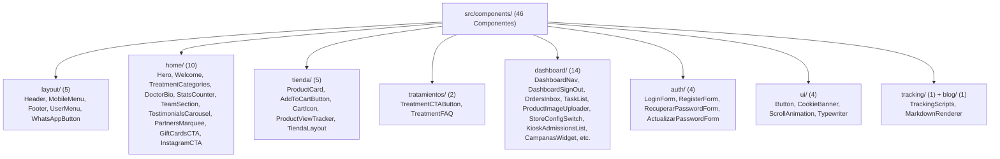

# 10 · Sistema de Diseño UX/UI, Componentes y Patrones Visuales

**Proyecto:** `dralandaburo.com`  
**Paradigma de Estilos:** CSS Modules con Custom Properties nativas (Cero Tailwind, Cero runtime CSS-in-JS)  
**Fecha de Verificación:** 14 de Octubre de 2026  
**Total de Componentes Relevados:** 46 componentes en `src/components/`  
**Estado:** ✅ 100% Verificado contra el código fuente e interfaz visual en producción.

---

## 1. Fundamentos del Sistema Visual y Brand Tokens

La identidad visual de `dralandaburo.com` combina una estética **editorial de alta gama (luxury aesthetic)** con la sobriedad y pulcritud requeridas por la medicina estética de precisión.

### 1.1 Paleta Cromática Central (`src/app/globals.css`)

| Token CSS | Valor Hex / RGBA | Uso Semántico y Racional de Diseño |
|---|---|---|
| `--color-negro` | `#000000` | Fondos de alto impacto (Hero, Footer, StatsCounter), tipografía de títulos principales y contraste editorial. |
| `--color-blanco` | `#FFFFFF` | Superficies limpias, tarjetas de producto, fondos de lectura clínica y texto sobre fondos oscuros. |
| `--color-champagne` | `#C5A47E` | Color acento insignia. Utilizado en insignias, bordes activos, botones primarios, estrellas de reseñas y micro-interacciones. |
| `--color-champagne-light` | `rgba(197, 164, 126, 0.15)`| Fondos sutiles, chips seleccionados y estados hover suaves. |
| `--color-champagne-dark` | `#A8875F` | Estado `:hover` y `:active` de botones y enlaces destacados. |
| `--color-gris` | `#848484` | Texto secundario, subtítulos descriptivos, metadatos y etiquetas muted. |
| `--color-gris-claro` | `#D2D3D3` | Separadores tenues, líneas divisorias y bordes inactivos. |
| `--color-bg-alt` | `#F8F8F8` | Fondos alternados de secciones para generar ritmo visual vertical. |
| `--color-border` | `#EAEAEA` | Contornos de tarjetas, inputs de formulario y bordes de tablas. |

> **Normalización de Tokens:** Para evitar discrepancias históricas generadas en diferentes olas de desarrollo, `globals.css` define alias normalizados: `--color-black` (alias de `--color-negro`), `--color-white`, `--color-gray`, `--font-heading` y `--font-body`.

### 1.2 Sistema Tipográfico

El sistema tipográfico utiliza dos familias que contrastan elegancia clásica con legibilidad funcional:

1. **Serif Editorial — Playfair Display (`var(--font-serif)` / `var(--font-heading)`):**
   - Empleada exclusivamente en encabezados (`h1`, `h2`, `h3`), citas textuales de testimonios, contadores numéricos y el logotipo institucional.
   - Aporta sofisticación, calidez humana y distinción médica.
2. **Sans-Serif Técnica — IBM Plex Sans (`var(--font-sans)` / `var(--font-body)`):**
   - Empleada en párrafos, etiquetas de formulario, botones, menús de navegación, fichas técnicas de tratamientos y tablas de datos del dashboard.
   - Aporta máxima claridad visual, legibilidad en pantallas retina y neutralidad técnica.

---

## 2. Catálogo de Componentes del Sistema (46 Componentes)

Los componentes están estructurados en 8 directorios temáticos bajo `src/components/`:

### Componentes Clave de Experiencia de Usuario
- **`Header.tsx` & `MobileMenu.tsx`:** Cabecera con detección de scroll. En la parte superior del Hero se mantiene transparente con texto blanco; al superar los 50px de scroll conmuta a fondo blanco sólido con `backdrop-blur: 10px`, borde inferior sutil y texto negro.
- **`WhatsAppButton.tsx`:** Botón flotante fijado en la esquina inferior derecha con micro-animación de pulso, visible a partir de los 300px de scroll vertical. Redirige directamente al canal oficial de atención.
- **`TestimonialsCarousel.tsx`:** Carrusel de reseñas verificadas de pacientes con puntuación de 5 estrellas, schema JSON-LD estructurado (`LocalBusiness` / `AggregateRating`) embebido para enriquecer el SEO de Google y controles táctiles accesibles.
- **`CookieBanner.tsx`:** Banner inferior discreto para cumplimiento RGPD. Bloquea la inyección de cookies de marketing (Meta Pixel) y analítica (GA4) hasta que el usuario otorga su consentimiento explícito, registrando la decisión en `/api/cookies/consent`.

---

## 3. Patrones de Interacción y Responsive Design

1. **Mobile-First con Breakpoints Estandarizados:**
   - Teléfonos móviles: `< 640px` (grillas a 1 columna, menús colapsados en drawer lateral).
   - Tablets: `640px - 1024px` (grillas a 2 columnas, adaptaciones de tarjetas).
   - Desktop: `> 1024px` (diseño completo a 3 y 4 columnas con ancho máximo de contenedor de 1280px).
2. **Micro-interacciones y Estados Hover:**
   - Las tarjetas de tratamiento y producto elevan su posición vertical (`transform: translateY(-4px)`) y proyectan una sombra suave (`box-shadow: 0 12px 30px rgba(0,0,0,0.06)`).
   - Los botones primarios realizan una transición de fondo champagne a champagne oscuro sin saltos de layout.
3. **Scroll Animations Desacopladas (`ScrollAnimation.tsx`):**
   - Utiliza la API nativa de `IntersectionObserver` para gatillar transiciones de entrada tipo fade-up con aceleración por hardware (`will-change: transform, opacity`).

---

## 4. Accesibilidad (a11y) y Estándares WCAG

- **Contraste de Color:** La tipografía corporal negra (`#000000`) sobre fondo blanco (`#FFFFFF`) y el texto gris (`#848484`) superan la relación de contraste mínima de 4.5:1 exigida por WCAG 2.1 nivel AA.
- **Navegación por Teclado:** Todos los enlaces, botones y campos interactivos cuentan con pseudo-clases `:focus-visible` que delimitan el foco mediante contornos champagne claros.
- **Atributos ARIA:** Los diálogos modales, selectores de pestañas y botones de carrusel implementan `aria-label`, `aria-expanded` y `aria-hidden` para lectores de pantalla.
- **Texto Alternativo en Medios:** Las fotografías de profesionales y tratamientos incluyen atributos `alt` descriptivos de índole médica y contextual.

---

## 5. Reglas Lingüísticas y Copybook Oficial

1. **Paciente, Nunca Cliente:** En todo el sitio web, dashboard, consentimientos y notificaciones por correo, la persona atendida se denomina exclusivamente **"paciente"**. La palabra "cliente" está formalmente prohibida.
2. **Español Rioplatense Neutro / Cálido:** Tratamiento de "vos" amigable pero profesional ("Conocé nuestros tratamientos", "Escribinos", "Tu bienestar").
3. **Rigurosidad Médica:** No se prometen resultados milagrosos. Se enfatiza la "armonización natural", el "cuidado médico ético" y la "seguridad anatómica".
