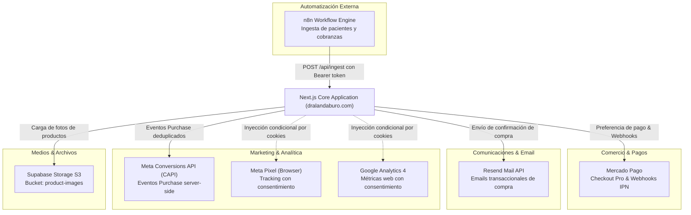
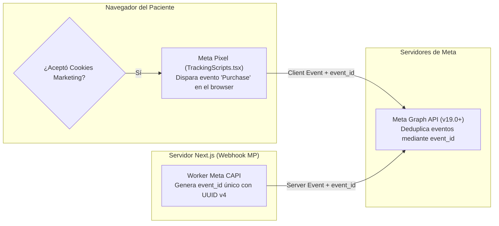

# 11 · Integraciones y Servicios Externos

**Proyecto:** `dralandaburo.com`  
**Fecha de Verificación:** 14 de Octubre de 2026  
**Servicios Externos Integrados:** Mercado Pago, Resend, n8n, Meta Graph API (CAPI/Pixel), Google Analytics 4, Supabase Storage, Google Maps  
**Estado:** ✅ 100% Verificado contra endpoints, secretos y configuraciones de producción.

---

## 1. Mapa de Integraciones Externas



---

## 2. Mercado Pago (Checkout Pro & Webhooks)

La integración con Mercado Pago administra el cobro de pedidos en la tienda online mediante la pasarela Checkout Pro.

### 2.1 Creación de Preferencias (`/api/checkout/mercadopago`)
- **Control de Paso Previo (Kill-Switch):** El Route Handler consulta la base de datos antes de interactuar con la pasarela. Si `store_config.checkout_enabled = false`, aborta inmediatamente retornando HTTP 403 Forbidden.
- **Payload de Preferencia:** Envía los ítems, el correo del comprador y las URLs de retorno:
  - `success`: `https://dralandaburo.com/tienda/pago/exito`
  - `failure`: `https://dralandaburo.com/tienda/pago/fallo`
  - `pending`: `https://dralandaburo.com/tienda/pago/pendiente`
- **Generación de Orden:** Inserta un registro en `orders` con `payment_status = 'pending'` y almacena el `mp_preference_id`.

### 2.2 Webhook IPN e Idempotencia (`/api/webhook/mercadopago`)
- **Lección Aprendida sobre Reintentos:** Mercado Pago envía notificaciones duplicadas en ráfagas de pocos segundos ante fluctuaciones de red.
- **Mecanismo de Idempotencia en Base de Datos:**
  1. Al recibir un evento, el webhook intenta registrar `event_id` en la tabla `mp_webhook_events`.
  2. La columna `event_id` cuenta con una restricción `UNIQUE`.
  3. Si la inserción arroja el código de error de PostgreSQL `23505` (`unique_violation`), el webhook descarta el procesamiento y responde inmediatamente `HTTP 200 OK` a Mercado Pago para confirmar la recepción sin duplicar el impacto.
  4. Si es nuevo, consulta la API de Mercado Pago (`GET /v1/payments/{id}`), actualiza `orders.payment_status = 'approved'`, descuenta el stock físico mediante una fila en `stock_movements` y dispara Resend y Meta CAPI.

---

## 3. Resend (Emails Transaccionales)

Servicio de mensajería electrónica para notificaciones transaccionales de alta entregabilidad.

- **Variables de Entorno:** `RESEND_API_KEY`.
- **Destinatarios:**
  1. **Comprador:** Confirmación de recepción de pedido, detalle de ítems adquiridos, dirección de retiro en Leandro N. Alem 45 y horarios de atención.
  2. **Personal Operativo:** Alerta inmediata de nueva venta web para proceder a su preparación física.
- **Trazabilidad en Base de Datos (`orders`):**
  - `buyer_email_sent` (boolean), `buyer_email_error` (text).
  - `staff_email_sent` (boolean), `staff_email_error` (text).
  - `emails_attempted_at` (timestamptz).
  - Permite al equipo de soporte auditar si un paciente no recibió el correo por un rebote o bloqueo de su proveedor de correo.

---

## 4. n8n Automation Engine (Ingesta Asíncrona)

El consultorio utiliza flujos de n8n para extraer registros de planillas administrativas o sistemas externos y volcarlos a la base de datos web.

- **Endpoints de Ingesta:**
  - `POST /api/ingest/payments`: Ingesta de cobros generales.
  - `POST /api/ingest/patients`: Sincronización del padrón de pacientes.
  - `POST /api/ingest/cash-payments`: Ingesta de movimientos de efectivo de consultorio.
  - `POST /api/ingest/campaigns`: Sincronización de campañas desde Meta Ads.
- **Seguridad:** Requiere la cabecera HTTP:
  ```http
  Authorization: Bearer <INGEST_SYNC_SECRET>
  ```
- **Bandeja de Desvíos (`ingest_review`):** Si un registro enviado por n8n hace referencia a un paciente no identificado o tiene inconsistencias numéricas, no se descarta; se inserta en `ingest_review` con `status = 'pending'`, donde permanece accesible para su corrección manual en el panel de `/dashboard/revision` (344 registros actualmente alojados).

---

## 5. Meta Graph API: Conversions API (CAPI) & Meta Pixel

Estrategia de medición híbrida para optimizar las campañas publicitarias en Instagram y Facebook sin pérdida de atribución por bloqueadores de anuncios (ad-blockers) o iOS ATT.



- **Deduplicación:** Se genera un identificador común `meta_capi_event_id`. Meta descarta el duplicado y conserva la versión más enriquecida (que incluye el hash SHA-256 del email y teléfono del comprador).
- **Trazabilidad en Base de Datos:** Las columnas `meta_capi_status`, `meta_capi_event_id`, `meta_capi_sent_at` y `meta_capi_error` en la tabla `orders` auditan el resultado de la transmisión.

---

## 6. Google Analytics 4 (GA4) y Cookie Consent

- **Implementación:** `src/components/tracking/TrackingScripts.tsx`.
- **Condición de Inyección:** Depende estrictamente del consentimiento otorgado en el `CookieBanner`.
- **RGPD / Privacidad:** Si el usuario rechaza las cookies de analítica, el script de `gtag` jamás se inyecta en el DOM. Si acepta, se registra en `cookie_consents` con una firma hash de su dirección IP (sin almacenar la IP cruda).

---

## 7. Supabase Storage (Almacenamiento de Archivos)

- **Bucket Principal:** `product-images` (Público con políticas de lectura anónima y escritura restringida a usuarios con rol `admin` o `operativo`).
- **Uso:** Almacena fotografías de productos de skincare y adjuntos médicos.
- **Componente de Carga:** `src/components/dashboard/ProductImageUploader.tsx`. Realiza optimización previa en cliente y sube el archivo a Supabase Storage devolviendo la URL CDN pública permanente.
