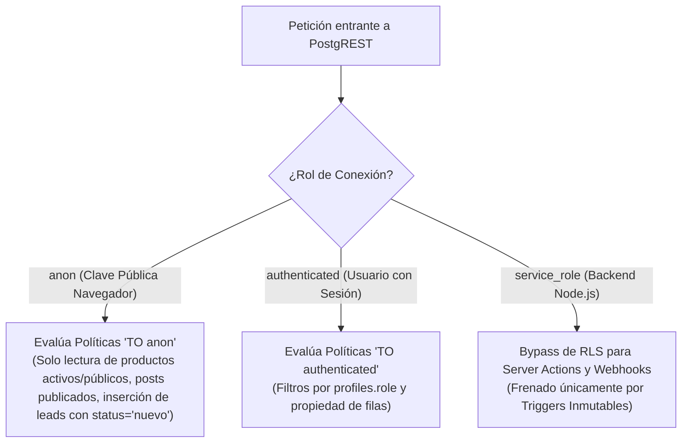

# 12 · Modelo de Seguridad, Políticas RLS y Protección de Datos

**Proyecto:** `dralandaburo.com`  
**Estándar de Seguridad:** Defensa en Profundidad y Principio de Menor Privilegio (Least Privilege)  
**Fecha de Verificación:** 14 de Octubre de 2026  
**Auditoría de RLS:** 100% de las tablas con datos sensibles protegidas por Row Level Security  
**Estado:** ✅ 100% Verificado contra el catálogo de PostgreSQL y el código fuente.

---

## 1. Modelo de Amenazas (STRIDE aplicado al Consultorio)

El modelo de amenazas protege dos activos esenciales: **la privacidad de los datos de salud de los 924 pacientes** y **la integridad de los libros contables y de stock**.

| Categoría STRIDE | Amenaza Potencial | Vector de Ataque | Mitigación Implementada |
|---|---|---|---|
| **Spoofing** (Suplantación) | Un atacante se hace pasar por la Dra. Landaburo o personal del consultorio. | Robo o reutilización de cookies de sesión antiguas. | `src/middleware.ts` invoca `supabase.auth.getUser()` en cada request, validando la firma del JWT directamente contra el servidor de GoTrue y forzando rotación de cookies. |
| **Tampering** (Alteración) | Modificación maliciosa o accidental del historial de inventario o borrado de productos. | Intento de `UPDATE` o `DELETE` directo vía API o consola de base de datos. | Triggers a nivel motor (`trg_deletion_audit_no_update`, `no_delete`) que lanzan excepción bloqueante incluso ante credenciales `service_role`. Restricción `ON DELETE RESTRICT` en `stock_movements`. |
| **Repudiation** (Repudio) | Un operador niega haber eliminado un tratamiento o modificado un precio. | Borrado sin registro de autoría. | La tabla `deletion_audit` captura de forma inmutable el snapshot JSONB completo de la fila eliminada, junto con `actor_id`, `actor_name`, `occurred_at` y el motivo escrito (`reason`). |
| **Information Disclosure** (Fuga de Información) | Lectura no autorizada del padrón de pacientes o cobros históricos desde el navegador. | Consultas a PostgREST utilizando la clave pública `NEXT_PUBLIC_SUPABASE_ANON_KEY`. | RLS habilitado en todas las tablas sensibles (`patients`, `payments`, `appointments`, `kiosk_admissions`). Las tablas de respaldo (`payments_backup_20260916` e `ingest_review_backup_20260916`) fueron selladas con RLS activo (cierre definitivo de FIX-080). |
| **Denial of Service** (DoS / Spam) | Inundación de consultas basura en el formulario de contacto para agotar cuotas de correo. | Bots enviando miles de peticiones `POST /api/contacto`. | Rate limiting persistente a nivel base de datos (`rate_limits`) con ventana deslizante de 15 minutos por IP (cierre de FIX-029). |
| **Elevation of Privilege** (Elevación de Privilegios) | Un recepcionista o cosmiatra intenta acceder a las métricas de facturación general. | Invocación manual del RPC `obtener_metricas_ejecutivas` vía REST. | El RPC cuenta con un guard en PL/pgSQL que verifica que el usuario autenticado posea rol `admin` o `medico`, arrojando error `42501` si no está autorizado. |

---

## 2. Matriz de Políticas RLS Tabla por Tabla

Auditoría completa de las 34 tablas presentes en el esquema `public`:

### Tabla de Auditoría RLS en Producción

| Tabla | RLS Habilitado | Acceso Anónimo (`anon`) | Acceso Autenticado (`authenticated`) | Acceso Backend (`service_role`) |
|---|:---:|---|---|---|
| `products` | ✅ SÍ | Solo lectura (`is_active = true AND is_public = true`). | Lectura completa. Escritura restringida a staff. | Total. |
| `product_categories` | ✅ SÍ | Solo lectura (`is_active = true`). | Lectura completa. Escritura admin/staff. | Total. |
| `treatments` | ✅ SÍ | Solo lectura (`is_active = true`). | Lectura y actualización según permisos RBAC. | Total. |
| `posts` | ✅ SÍ | Solo lectura (`is_published = true`). | Gestión editorial para editores/admin. | Total. |
| `leads` | ✅ SÍ | **Solo INSERT** (`full_name, email NOT NULL, status='nuevo'`). | Lectura y gestión para personal de consultorio. | Total. |
| `patients` | ✅ SÍ | ❌ Denegado totalmente. | Solo lectura/escritura para personal interno. | Total. |
| `payments` | ✅ SÍ | ❌ Denegado totalmente. | Filtrado por rol. RPC métricas restringida. | Total. |
| `appointments` | ✅ SÍ | ❌ Denegado totalmente. | Lectura del profesional asignado o staff. | Total. |
| `kiosk_admissions` | ✅ SÍ | ❌ Denegado totalmente. | Visualización en `/dashboard/operativo`. | Inserción vía endpoint `/api/kiosco/admision`. |
| `orders` | ✅ SÍ | ❌ Denegado totalmente. | Lectura de pedidos propios por paciente. | Total para webhooks y preparación. |
| `order_items` | ✅ SÍ | ❌ Denegado totalmente. | Lectura condicionada a la orden padre. | Total. |
| `stock_movements` | ✅ SÍ | ❌ Denegado totalmente. | Lectura para staff. Inserción permitida, **UPDATE/DELETE bloqueados por BD**. | Total (sujeto a triggers). |
| `deletion_audit` | ✅ SÍ | ❌ Denegado totalmente. | **Solo lectura/insert para admin**. **UPDATE/DELETE bloqueados por trigger**. | Bloqueado por triggers. |
| `role_section_defaults`| ✅ SÍ | ❌ Denegado totalmente. | Lectura para cálculo de layout. | Total. |
| `user_section_overrides`| ✅ SÍ | ❌ Denegado totalmente. | Lectura para cálculo de layout. | Total. |
| `rate_limits` | ✅ SÍ | ❌ Denegado totalmente. | Denegado en cliente. | Gestionado exclusivamente por endpoints. |
| `mp_webhook_events` | ✅ SÍ | ❌ Denegado totalmente. | Denegado en cliente. | Gestionado exclusivamente por webhook. |
| `cookie_consents` | ✅ SÍ | **Solo INSERT** (registro de decisión). | Lectura para auditoría técnica. | Total. |
| `payments_backup_20260916`| ✅ SÍ | ❌ Denegado totalmente (FIX-080). | ❌ Denegado en cliente. | Solo service_role. |
| `ingest_review_backup_20260916`| ✅ SÍ | ❌ Denegado totalmente (FIX-080). | ❌ Denegado en cliente. | Solo service_role. |

---

## 3. Gestión de Secretos y Principio de Menor Privilegio

### 3.1 Aislamiento de Claves de Supabase
- **`NEXT_PUBLIC_SUPABASE_ANON_KEY`:** 
  - Expuesta de forma visible en el bundle JavaScript del navegador del paciente.
  - Concede únicamente privilegios anónimos controlados estrictamente por las políticas RLS. Jamás puede acceder a datos de pacientes ni cobros.
- **`SUPABASE_SERVICE_ROLE_KEY`:** 
  - Reside exclusivamente en variables de entorno del servidor Node.js (`.env.local` en raíz y en `.next/standalone/.env.local`).
  - Nunca se inyecta en el cliente web ni se expone en código fuente.
  - Utilizada exclusivamente en Route Handlers autorizados y Server Actions de administración.

### 3.2 Secretos de Integración y Sincronización
- **`INGEST_SYNC_SECRET`:** Token criptográfico compartido con n8n para autenticar la ingesta de cobros y pacientes.
- **`BLOG_SYNC_SECRET`:** Token Bearer para permitir que sistemas externos publiquen artículos médicos en el blog.
- **`MP_ACCESS_TOKEN` / `MP_WEBHOOK_SECRET`:** Credenciales de producción de Mercado Pago para procesar cobros y verificar la firma HMAC-SHA256 de las notificaciones entrantes.
- **`RESEND_API_KEY`:** Credencial de envío de emails transaccionales.

---

## 4. Desacople de Contacto Anónimo y Corrección de Fugas Históricas

### 4.1 Desacople de `/api/contacto` (Bloque 2 del 14/10)
Anteriormente, el endpoint de contacto utilizaba `createAdminClient()` (clave `service_role`) para insertar leads, lo que representaba un riesgo de escalada de privilegios en caso de inyección o vulnerabilidad en el handler.
- **Solución Implementada:** Se desacopló la inserción al cliente anónimo `createClient(URL, ANON_KEY)`. La inserción descansa en la política RLS `Permitir inserción de leads a usuarios anónimos` de PostgreSQL, que garantiza a nivel de motor que solo pueden crearse registros con `status = 'nuevo'`, eliminando cualquier posibilidad de adulteración.

### 4.2 Sellado RLS en Tablas de Respaldo (FIX-080)
Las tablas `payments_backup_20260916` (1,072 filas) e `ingest_review_backup_20260916` (320 filas) fueron creadas originalmente como respaldos temporales durante la migración contable de septiembre sin políticas de RLS explícitas, lo que permitía su lectura anónima vía PostgREST.
- **Solución Implementada:** El DDL consolidado ejecutó `ALTER TABLE ... ENABLE ROW LEVEL SECURITY` en ambas tablas sin crear políticas de lectura pública, sellándolas por completo contra cualquier consulta externa.
