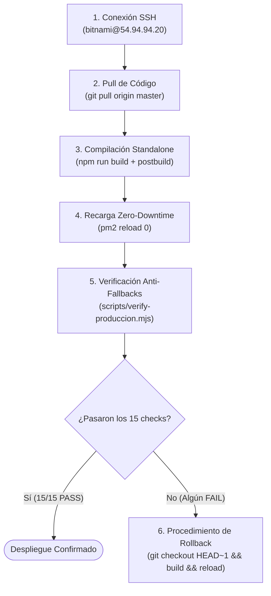

# 13 · Manual de Operación, Despliegue y Mantenimiento

**Proyecto:** `dralandaburo.com`  
**Host de Producción:** AWS EC2 Bitnami Linux (`54.94.94.20`)  
**Directorio en Servidor:** `/opt/dra-landaburo`  
**Gestor de Procesos:** PM2 (id `0`, app `dra-landaburo`)  
**Servidor Web Frontal:** Apache 2.4 (Reverse Proxy SSL)  
**Fecha de Verificación:** 14 de Octubre de 2026  
**Estado:** ✅ 100% Verificado contra la infraestructura viva de producción.

---

## 1. Guía Paso a Paso para Despliegues en Producción

El flujo de despliegue oficial para actualizar el sitio web y el dashboard de consultorio sigue un protocolo estricto de seis pasos secuenciales:



### Paso 1: Conexión SSH al Servidor EC2
Desde la máquina autorizada de Antigravity:
```bash
ssh -i "C:/Users/User/.ssh/antigravity_dralandaburo" bitnami@54.94.94.20
```

### Paso 2: Actualización del Repositorio
Ubicarse en el directorio del proyecto y traer los últimos cambios del branch `master`:
```bash
cd /opt/dra-landaburo
git pull origin master
```

### Paso 3: Instalación de Dependencias (si cambiaron)
Si se modificó `package.json` o `package-lock.json`:
```bash
npm ci
```

### Paso 4: Compilación del Proyecto Next.js
Ejecutar la compilación en modo producción:
```bash
npm run build
```
> **Atención al Script Postbuild:** La ejecución de `npm run build` gatilla automáticamente `scripts/copy-standalone-assets.js`. Este script es vital porque copia `.next/static`, `public/` y el archivo `.env.local` dentro del directorio `.next/standalone/`. Sin este paso, el runtime empaquetado de producción no reconocería cambios en variables ni activos multimedia.

### Paso 5: Recarga en Caliente con PM2 (Zero-Downtime)
Recargar el proceso Node.js sin interrumpir las conexiones activas:
```bash
pm2 reload 0
pm2 status
```
Verificar que el estado indique `online` y que el contador de reinicios no esté aumentando indefinidamente.

### Paso 6: Verificación Automatizada Post-Despliegue
Ejecutar el script de verificación anti-fallbacks contra la URL viva y la base de datos de Supabase:
```bash
node --env-file=.env.local scripts/verify-produccion.mjs
```
El despliegue solo se considera exitoso si reporta **15/15 checks en [PASS]**.

---

## 2. Procedimiento de Rollback Inmediato

Si una actualización genera errores en consola, falla los checks automatizados o interrumpe la navegación pública, se debe ejecutar el rollback inmediato:

```bash
cd /opt/dra-landaburo

# 1. Regresar al commit estable anterior
git reset --hard HEAD~1

# 2. Recompilar la versión estable
npm run build

# 3. Recargar el servidor Node.js
pm2 reload 0

# 4. Confirmar que la versión anterior está operativa
node --env-file=.env.local scripts/verify-produccion.mjs
```

---

## 3. Protocolo Estricto para Migraciones de Base de Datos (DDL)

### 3.1 La Regla de Oro del SQL Editor de Supabase
⚠️ **NUNCA encapsular múltiples sentencias DDL dentro de un único bloque `BEGIN ... COMMIT` masivo.**

* **Causa del Incidente del 10/10:** En la ronda del 10 de octubre, una sentencia menor generó una inconsistencia no fatal dentro de una transacción transaccional cerrada; Supabase realizó un `ROLLBACK` silencioso completo de todo el archivo DDL, provocando que ninguna columna nueva (`meta_capi_*`, `attention_hours`, `allow_oversell_online`) ni tabla (`mp_webhook_events`, `rate_limits`) se creara realmente en producción a pesar de haber pegado el script.
* **Regla Obligatoria:** Las migraciones deben estructurarse y ejecutarse **en pasos independientes secuenciales**, cada uno con su propio bloque o directamente en comandos individuales sin `BEGIN`/`COMMIT` envolvente.

### 3.2 Recarga Forzada de la Cache de PostgREST
Luego de ejecutar cualquier `ALTER TABLE` o `CREATE TABLE` en Supabase, se debe forzar a PostgREST a recargar su catálogo en memoria para evitar el error `PGRST204`:
```sql
NOTIFY pgrst, 'reload schema';
```

---

## 4. Gestión de Variables de Entorno y Standalone

### 4.1 Variables de Entorno de Producción (`.env.local`)

| Variable | Tipo | Propósito |
|---|---|---|
| `NEXT_PUBLIC_SUPABASE_URL` | Pública | URL del proyecto Supabase (`https://mdletvbgwzbpenzevurr.supabase.co`). |
| `NEXT_PUBLIC_SUPABASE_ANON_KEY` | Pública | Clave pública de cliente sujeta a RLS. |
| `SUPABASE_SERVICE_ROLE_KEY` | **Secreta** | Clave superadministradora para backend. |
| `MP_ACCESS_TOKEN` | **Secreta** | Token de producción de Mercado Pago. |
| `MP_WEBHOOK_SECRET` | **Secreta** | Clave para validar firma HMAC de webhooks de pago. |
| `RESEND_API_KEY` | **Secreta** | Token de Resend para notificaciones de compra. |
| `INGEST_SYNC_SECRET` | **Secreta** | Token Bearer para autorizar ingesta de n8n. |
| `BLOG_SYNC_SECRET` | **Secreta** | Token Bearer para publicación externa de posts. |
| `META_PIXEL_ID` | Pública | ID numérico del Pixel de Meta para tracking web. |
| `META_CAPI_ACCESS_TOKEN` | **Secreta** | Token de acceso a Meta Graph API (Conversiones). |
| `GA4_MEASUREMENT_ID` | Pública | ID de medición de Google Analytics 4 (`G-XXXXXX`). |

### 4.2 Actualización de Variables sin Recompilar
Si se modifica una variable en `/opt/dra-landaburo/.env.local` sin ejecutar un build completo de Next.js, se debe replicar manualmente hacia el directorio standalone antes de recargar PM2:
```bash
cp /opt/dra-landaburo/.env.local /opt/dra-landaburo/.next/standalone/.env.local
pm2 reload 0
```
Sin esta copia manual, PM2 continuará ejecutando el proceso con los valores en memoria del archivo anterior.

---

## 5. Mantenimiento Preventivo y Tareas Periódicas

1. **Revisión de Logs de PM2:**
   ```bash
   pm2 logs dra-landaburo --lines 100 --err
   ```
2. **Monitoreo de Espacio en Disco:**
   ```bash
   df -h /
   ```
   Verificar que los logs de Apache (`/opt/bitnami/apache2/logs/`) y los builds antiguos no saturen la partición raíz de EC2.
3. **Limpieza de Rate Limits Antiguos:**
   La tabla `rate_limits` acumula claves expiradas. Se recomienda ejecutar periódicamente en el SQL Editor de Supabase:
   ```sql
   DELETE FROM public.rate_limits WHERE reset_at < now();
   ```
