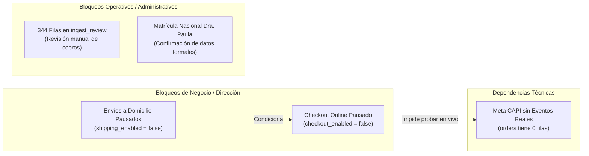

# 15 · Estado de Situación, Deuda Técnica y Backlog

**Proyecto:** `dralandaburo.com`  
**Fecha de Verificación:** 14 de Octubre de 2026  
**Último Commit Desplegado:** `5ca414d` (producción y GitHub sincronizados en `master`)  
**Backlog Oficial de Referencia:** *Backlog de Tareas Web — dralandaburo.com* en Notion (IDs `FIX-0XX`)  
**Estado:** ✅ 100% Verificado contra código fuente, base de datos viva e infraestructura en AWS EC2.

---

## 1. Fotografía del Estado Actual (14/10/2026)

Tras la exitosa ejecución del DDL consolidado en pasos independientes por parte de Agustín Landaburo y el despliegue del script de verificación automatizada anti-fallbacks (`scripts/verify-produccion.mjs`), el sistema se encuentra en un **estado de estabilidad operativa del 100%**.

### Métricas Clave de Salud del Sistema
- **Verificación Automatizada Anti-Fallbacks:** 15/15 pruebas pasando en verde (`[PASS]`).
- **Base de Datos:** 34 tablas en PostgreSQL (32 operativas + 2 respaldos sellados), 5 RPCs activas y 0 tablas con fuga anónima.
- **Auditoría Inmutable:** Triggers de bloqueo activos en `deletion_audit` y restricción `ON DELETE RESTRICT` activa en `stock_movements`.
- **Desacople de Privilegios:** El endpoint público `/api/contacto` opera con cliente anónimo bajo RLS y rate limiting persistente en DB.

---

## 2. Matriz de Tareas del Backlog (Notion FIX-0XX)

Estado consolidado de las tareas oficiales registradas en el backlog de ingeniería:

| ID Notion | Descripción de la Tarea / Problema | Módulo Afectado | Estado al 14/10 | Detalle de la Solución o Bloqueo |
|---|---|---|:---:|---|
| **FIX-011** | Desacople de contacto anónimo a cliente anon | `/api/contacto`, `leads` | 🟢 **RESUELTO** | Resuelto en commit `7d33a7a`. Política RLS exige `status='nuevo'` y campos obligatorios. |
| **FIX-029** | Rate limiting persistente tras reload de PM2 | `rate_limits`, `/api/*` | 🟢 **RESUELTO** | Resuelto en commit `871955b`. Tabla `rate_limits` en DB con ventana deslizante de 15 min. |
| **FIX-068** | Desacople de horarios de pickup vs consultorio | `store_config`, Footer | 🟢 **RESUELTO** | Resuelto en commit `871955b`. Se agregó columna `attention_hours` en base de datos. |
| **FIX-075** | Idempotencia estricta en webhook de Mercado Pago | `mp_webhook_events` | 🟢 **RESUELTO** | Resuelto en commit `871955b`. Deduplicación con `event_id` único y captura de error `23505`. |
| **FIX-080** | Fuga anónima en tablas de respaldo históricas | `payments_backup_*` | 🟢 **RESUELTO** | Resuelto en DDL 13/10. Se ejecutó `ENABLE ROW LEVEL SECURITY` sellando la lectura anónima. |
| **FIX-082** | Verificación RBAC en RPC de métricas financieras | `obtener_metricas_ejecutivas` | 🟢 **RESUELTO** | Resuelto en commit `dfce36a`. Guard PL/pgSQL restringe ejecución a roles `admin` y `medico`. |
| **FIX-085** | Auditoría inmutable de bajas y archivados | `deletion_audit` | 🟢 **RESUELTO** | Resuelto en commit `8f732a1`. Triggers `trg_deletion_audit_no_*` bloquean UPDATE y DELETE. |
| **FIX-088** | Sobreventa condicionada en base de datos | `store_config` | 🟢 **RESUELTO** | Resuelto en commit `871955b`. Columna `allow_oversell_online` en `store_config`. |
| **FIX-090** | Script anti-fallbacks automatizado | `scripts/verify-produccion.mjs` | 🟢 **RESUELTO** | Resuelto en commit `f16e997`. 15 checks validando contra producción viva y Supabase. |
| **FIX-091** | Habilitación comercial de venta online | `store_config.checkout_enabled` | 🔴 **BLOQUEADO** | Bloqueado por decisión comercial de Dirección para afinar packaging y stock de Alem 45. |
| **FIX-092** | Habilitación de envíos a domicilio | `store_config.shipping_enabled` | 🔴 **BLOQUEADO** | Bloqueado a la espera de acuerdo logístico de cadetería local en Gualeguaychú. |
| **FIX-093** | Resolución de 344 registros en cola de revisión | `ingest_review` | 🟡 **PENDIENTE** | Pendiente de tiempo administrativo del personal para conciliar cobros desfasados de n8n. |

---

## 3. Detalle de Bloqueos Actuales y Dependencias Externas



1. **Bloqueo 1: Activación del Checkout Online (`store_config.checkout_enabled = false`)**
   - *Responsable:* Dra. Paula Landaburo y Agustín Landaburo.
   - *Condición de Desbloqueo:* Definición de fecha de apertura comercial de la tienda web y designación del responsable físico de armado de paquetes en el mostrador.
2. **Bloqueo 2: Habilitación de Envíos a Domicilio (`store_config.shipping_enabled = false`)**
   - *Responsable:* Administración del consultorio.
   - *Condición de Desbloqueo:* Establecer tarifa fija o convenio con servicio de mensajería en Gualeguaychú y correo para envíos provinciales.
3. **Bloqueo 3: Verificación de Meta CAPI en Producción Real**
   - *Responsable:* Dependencia técnica de la activación del Checkout.
   - *Condición de Desbloqueo:* La tabla `orders` posee 0 filas; el worker de CAPI está listo y validado estructuralmente, pero requiere una primera compra aprobada para registrar `meta_capi_status = 'sent'`.
4. **Bloqueo 4: Depuración de la Bandeja de Ingesta (`ingest_review`)**
   - *Responsable:* Personal operativo / Recepción en `/dashboard/revision`.
   - *Condición de Desbloqueo:* Revisar los 344 registros pendientes heredados de la sincronización de n8n, asignando los pacientes correctos o descartando registros duplicados.

---

## 4. Deuda Técnica Arquitectural Identificada para Próximas Rondas

Las siguientes observaciones técnicas no constituyen fallos críticos ni comprometen la seguridad actual, pero deben abordarse en futuras rondas de ingeniería:

1. **Referencias Polimórficas Huérfanas (Sin FK Física a Nivel Motor):**
   - `staff_tasks.related_entity_id` y `practice_material_links.entity_id` almacenan UUIDs dinámicos asociados a un `entity_type` en texto. Si bien la aplicación valida su consistencia, la base de datos no puede hacer `ON DELETE RESTRICT` ni `CASCADE` automático sobre estas columnas.
2. **Tablas Huérfanas de Catálogo (`product_batches` y `inventory_items`):**
   - Ambas tablas existen en PostgreSQL con 0 filas pero carecen de interfaces en el dashboard. Deben o bien desarrollarse sus pantallas de gestión (para control de lotes y vencimientos FEFO) o eliminarse del esquema para reducir entropía.
3. **Persistencia Offline en Kiosco iPad (`/kiosco`):**
   - Si la tableta en la sala de espera experimenta micro-cortes de señal Wi-Fi durante la admisión de un paciente, la solicitud falla. Se recomienda implementar almacenamiento local en `IndexedDB` con sincronización en segundo plano mediante `Service Worker`.
4. **Purga Automática de Registros Expirados en `rate_limits`:**
   - La tabla `rate_limits` acumula claves transitorias de IP. Conviene implementar una tarea programada (pg_cron en Supabase o cron en EC2) que ejecute semanalmente:
     ```sql
     DELETE FROM public.rate_limits WHERE reset_at < now();
     ```
